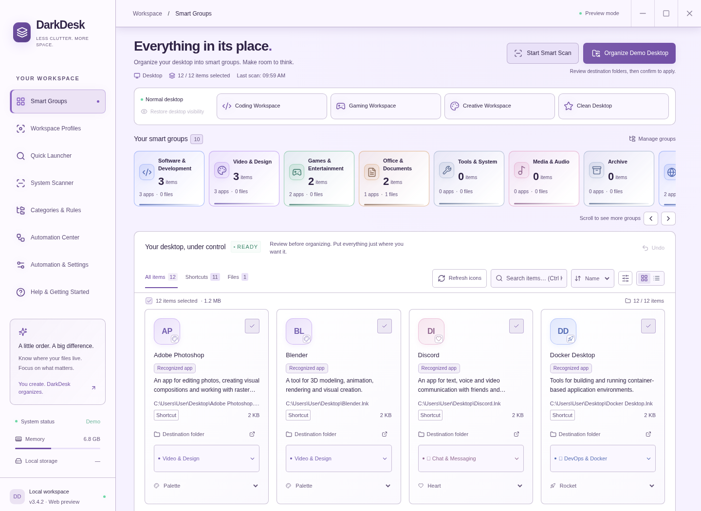

<div align="center">
  
  <p><strong>A calmer desktop. A clearer workspace.</strong></p>
  <p>Find your apps, organize real files, and switch focus with a local desktop companion.<br />Preview every change. Keep control. Undo when you need to.</p>
  <a href="https://github.com/Huseyinhk61/DarkDesk/releases/latest"><strong>Download for Windows</strong></a> ·
  <a href="#features">Explore features</a> ·
  <a href="#run-from-source">Run from source</a> ·
  <a href="https://github.com/Huseyinhk61/DarkDesk/issues">Report an issue</a>
  <br /><br />
  <a href="https://github.com/Huseyinhk61/DarkDesk/actions/workflows/ci.yml"></a>
  <a href="https://github.com/Huseyinhk61/DarkDesk/actions/workflows/windows.yml"></a>
  <a href="https://github.com/Huseyinhk61/DarkDesk/releases"></a>
  
  
  
  <br /><br />
  
  <p><sub>Actual browser-preview screenshot with sample data. Native file operations and original app icons require the Electron desktop app.</sub></p>
</div>

## Get DarkDesk

Open **[GitHub Releases](https://github.com/Huseyinhk61/DarkDesk/releases/latest)** and choose a Windows x64 package:

| Download                                  | Best for                                                                         |
| :---------------------------------------- | :------------------------------------------------------------------------------- |
| **DarkDesk-Setup-&lt;version&gt;.exe**    | Everyday use: installation wizard, desktop shortcut, and in-app updates.         |
| **DarkDesk-Portable-&lt;version&gt;.exe** | Trying the app without installing it. Updates require downloading a new package. |
| **SHA256SUMS.txt**                        | Checking the integrity of downloaded release files.                              |

No Node.js or terminal is needed for the packaged app. Before replacing an older installation, quit DarkDesk from its system-tray menu. Packages are currently **unsigned**; Windows may show a publisher or SmartScreen warning.

Release downloads become available after the [Windows packaging workflow](https://github.com/Huseyinhk61/DarkDesk/actions/workflows/windows.yml) finishes successfully. For installation, update access, and troubleshooting, see the [update guide](docs/UPDATES.md) and [Windows guide](docs/WINDOWS.md).

## Features

| Capability                                | What it does                                                                                                                                              |
| :---------------------------------------- | :-------------------------------------------------------------------------------------------------------------------------------------------------------- |
| **Real desktop organization**             | Move or copy selected desktop files into physical category folders. Review destinations and conflicts before applying changes.                            |
| **Three scanning sources**                | Switch between Desktop, Installed apps, and Downloads. Installed programs stay in place; organization creates shortcuts instead.                          |
| **Smart groups and custom rules**         | Start with **10 main groups and 25 groups in total**. Add nested categories, keyword or regex rules, and remembered manual assignments.                   |
| **Original app icons and useful details** | Read native app icons where available. Inspect file metadata and local purpose descriptions for **91 recognized apps**, with clearly labeled fallbacks.   |
| **Focus profiles**                        | Keep relevant desktop items visible for coding, gaming, or creative work. Restore visibility when you leave the profile.                                  |
| **Quick launcher**                        | Press **Alt+X** on a new installation to search indexed apps, files, and commands. Assign your own global shortcuts; saved custom bindings are preserved. |
| **Optional automation**                   | Enable archive rules for older files and routing for stable Downloads files. File operations are logged and can be undone.                                |
| **Make it comfortable**                   | Choose **11 color palettes plus the system theme**, **4 font-family choices**, and **5 icon packs**. Adjust text size, density, and motion.               |
| **English and Turkish**                   | Change the interface language without restarting. Native tray text follows the selected language.                                                         |
| **In-app updates**                        | Installed Windows builds can check public GitHub Releases without a personal token. Get notified, then download and restart when you choose.              |

### Organize in four steps

1. **Scan** the source you want to work with.
2. **Review** categories, search results, and selected items. Drag a card onto a group to change its assignment.
3. **Preview and apply** the move/copy plan. Installed apps receive shortcuts; their installation folders are untouched.
4. **Undo** from the result notification or persistent operation history if you want to reverse the change.

<table>
  <tr>
    <td align="center"><strong>Make it yours</strong></td>
    <td align="center"><strong>Light and readable</strong></td>
  </tr>
  <tr>
    <td></td>
    <td></td>
  </tr>
</table>

<details>
<summary><strong>More previews: launcher, profiles, and organization</strong></summary>

Screenshots show the English browser preview with sample data. Physical destination folder names are independent of the interface language; the app also supports Turkish.

|                                   Quick launcher                                    |                           Focus profiles                            |
| :---------------------------------------------------------------------------------: | :-----------------------------------------------------------------: |
|                           |                   |
|                             **Preview before applying**                             |                        **Review the result**                        |
|  |  |


</details>

## Designed for your desktop

**Windows is the primary platform.** DarkDesk uses the operating system's desktop location, including OneDrive-redirected desktops. The app stays available in the system tray after you close the window; use **Quit** from the tray to exit fully.

Linux supports desktop operations, application discovery, and `.desktop` shortcuts; an AppImage build command is included. Native Windows folder-icon customization and the Windows installer updater are platform-specific. macOS deep application scanning and signed/notarized distribution are not currently provided.

Global shortcuts depend on the operating system and other apps. DarkDesk lets you record another combination when a shortcut is already taken. Native icons and executable metadata depend on the files and permissions available on your machine.

## Privacy and file protection

Scanning, classification, and app descriptions run locally. Desktop organization requires no account or cloud AI service, and file lists are not uploaded. Release checks and downloads use GitHub; update access is documented in the [update guide](docs/UPDATES.md).

- **Review first:** manual organization uses an explicit preview and confirmation. Background file routing runs only when you enable its automation rules.
- **No overwrites:** conflicting destinations are skipped. Copies are verified before move sources are removed.
- **Recoverable history:** operations keep a persistent log. Undo checks file contents and stops when another change would make reversal unsafe.
- **Restricted native bridge:** the renderer has no Node.js access; native operations use a limited IPC interface with isolation and sandboxing.

Undo is a recovery aid, not a backup. Multi-file operations cannot be atomic across the whole operating system, and external changes or interruptions can require manual recovery. See [organization and recovery](docs/ORGANIZATION.md) for details.

## Run from source

Use **Node.js 24 LTS** (Node.js 22.12+ is supported), npm, and a graphical desktop session.

```sh
git clone https://github.com/Huseyinhk61/DarkDesk.git
cd DarkDesk
npm ci
npm run desktop
```

Run these commands **inside the folder containing `package.json`**. Running npm from your user home folder causes an `ENOENT` / missing `package.json` error.

Without Git, [download the source ZIP](https://github.com/Huseyinhk61/DarkDesk/archive/refs/heads/main.zip), extract it, and open a terminal inside `DarkDesk-main`. On Windows, `DarkDesk-Baslat.cmd` can install dependencies and start the app from that folder.

To preview the interface in a browser:

```sh
npm run dev
```

Open the address printed by Vite. **Browser mode uses sample data and cannot organize real desktop files.** Use `npm run desktop` for native operations.

### Build and test

| Command                | Purpose                                                      |
| :--------------------- | :----------------------------------------------------------- |
| `npm run build`        | Build the production interface.                              |
| `npm test`             | Run service, model, and settings tests with temporary files. |
| `npm run test:e2e`     | Run Chromium interface scenarios with Playwright.            |
| `npm run test:desktop` | Exercise real Electron IPC against an isolated desktop.      |
| `npm run check`        | Run service tests, production build, and browser tests.      |
| `npm run dist:win`     | Build Setup and Portable EXEs into `release/`.               |
| `npm run dist:linux`   | Build a Linux AppImage into `release/`.                      |

Install Chromium once with `npx playwright install chromium` before browser tests. Headless Linux requires `xvfb-run -a npm run test:desktop` for native tests. The [validation report](docs/VALIDATION.md) records test results and platform-specific limits; cross-built EXEs have been checked for integrity, but a live Windows install/upgrade has not been verified in the Linux development environment.

## Documentation

- [Windows setup and troubleshooting](docs/WINDOWS.md)
- [Installation, in-app updates, and publishing](docs/UPDATES.md)
- [Organization, icons, and recovery](docs/ORGANIZATION.md)
- [Themes, readability, and everyday use](docs/USABILITY.md)
- [Native icons, app details, and shortcuts](docs/DESKTOP-UX.md)
- [Profiles, launcher, and automation architecture](docs/ECOSYSTEM.md)
- [Validation report](docs/VALIDATION.md) · [Changelog](CHANGELOG.md)
- [Repository publishing and About settings](docs/REPOSITORY.md)

## Contribute

Read the [contribution guide](CONTRIBUTING.md), then open an [issue](https://github.com/Huseyinhk61/DarkDesk/issues) with your app version, operating system, reproduction steps, and relevant errors. Remove personal paths and credentials from logs or screenshots before sharing them.

**License:** no license file has been added yet. Public source availability does not grant a separate open-source license.
