<div align="center">
  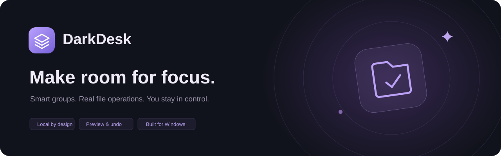
  <p><strong>A calmer desktop. A clearer workspace.</strong></p>
  <p>Find your apps, organize real files, and build a focused workspace with local desktop tools.<br />Preview every change. Keep control. Undo when you need to.</p>
  <a href="https://github.com/Huseyinhk61/DarkDesk/releases/latest"><strong>Download for Windows & Linux</strong></a> ·
  <a href="#features">Explore features</a> ·
  <a href="#run-from-source">Run from source</a> ·
  <a href="https://github.com/Huseyinhk61/DarkDesk/issues">Report an issue</a>
  <br /><br />
  <a href="https://github.com/Huseyinhk61/DarkDesk/actions/workflows/ci.yml"></a>
  <a href="https://github.com/Huseyinhk61/DarkDesk/actions/workflows/windows.yml"></a>
  <a href="https://github.com/Huseyinhk61/DarkDesk/releases"></a>
  
  
  
  <br /><br />
  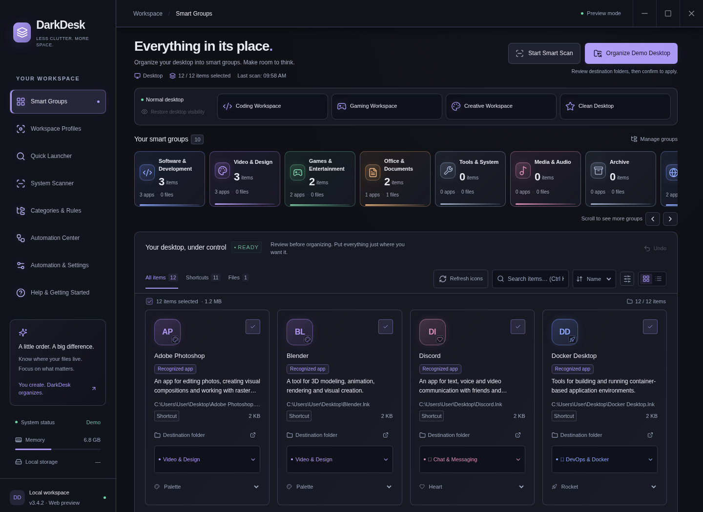
  <p><sub>Actual browser-preview screenshot with sample data. Native file operations and original app icons require the Electron desktop app.</sub></p>
</div>

## New in 3.12.0

Pin your own currency pairs and choose the launcher's default conversion currency. Type `1 usd`, `1 usd tl`, or `50 eur to gbp`; the built-in guide shows examples. Pick from **34 category icons** and **seven folder styles**. Widgets now use fixed views, paged notes/tasks and consistent background opacity; System Monitor lets you inspect every detected drive. A free, manually configured **MET Norway weather widget** joins the gallery. Default Mode has an editable **Ctrl+Alt+0** shortcut.

German, French and Spanish join Turkish/English as **beta core-interface translations**, with English fallback for advanced help. Native system actions detect available Linux/macOS providers; Windows audio uses explicit Core Audio operations. The separate [Microsoft Store submission workflow](docs/MICROSOFT_STORE.md) is ready for the owner's Partner Center identity and certification checks. DarkDesk is **not yet listed in Microsoft Store**.

## Get DarkDesk

Open **[GitHub Releases](https://github.com/Huseyinhk61/DarkDesk/releases/latest)** and choose a Windows or Linux x86-64 package:

| Download                                     | Best for                                                                         |
| :------------------------------------------- | :------------------------------------------------------------------------------- |
| **DarkDesk-Setup-&lt;version&gt;.exe**       | Everyday use: installation wizard, desktop shortcut, and in-app updates.         |
| **DarkDesk-Portable-&lt;version&gt;.exe**    | Trying the app without installing it. Updates require downloading a new package. |
| **DarkDesk-&lt;version&gt;-x86_64.AppImage** | Linux desktop application, with in-app AppImage updates.                         |
| **DarkDesk-&lt;version&gt;-amd64.deb**       | Ubuntu/Debian installation with desktop-menu integration.                        |
| **SHA256SUMS.txt**                           | Checking the integrity of downloaded release files.                              |

No Node.js or terminal is needed for the packaged app. Before replacing an older installation, quit DarkDesk from its system-tray menu. Packages are currently **unsigned**; Windows may show a publisher or SmartScreen warning.

The update panel includes **What’s new in this release**, and a sidebar indicator remains visible after dismissing an available-update notice. Failed checks retry after 15 minutes.

Release downloads become available after the [desktop packaging workflow](https://github.com/Huseyinhk61/DarkDesk/actions/workflows/windows.yml) finishes successfully. For installation, update access, and troubleshooting, see the [update guide](docs/UPDATES.md) and [Windows guide](docs/WINDOWS.md).

See the [Linux installation and platform guide](docs/LINUX.md) for DEB/AppImage prerequisites and supported features.

## Features

| Capability                                | What it does                                                                                                                                                                                                                   |
| :---------------------------------------- | :----------------------------------------------------------------------------------------------------------------------------------------------------------------------------------------------------------------------------- |
| **Real desktop organization**             | Move or copy selected desktop files into physical category folders. Review destinations and conflicts before applying changes.                                                                                                 |
| **Independent scanning sources**          | Switch between Desktop, Installed apps, Downloads and a chosen application folder. Desktop discovery includes personal and common Windows shortcuts. Installed programs stay in place; organization creates shortcuts instead. |
| **Smart groups and custom rules**         | Start with **11 main groups and 30 groups in total**. Browse nested categories with accurate parent totals, matching reasons, a review filter, and keyword or regex rules.                                                     |
| **Original app icons and useful details** | Read native icons and Windows File Description metadata. Get offline descriptions for **191 apps**, name/type suggestions, or write your own explanation.                                                                      |
| **Focus profiles**                        | Keep relevant desktop items visible for coding, gaming, or creative work. Restore visibility when you leave the profile.                                                                                                       |
| **Quick launcher**                        | Press **Alt+X** to search apps, calculate, convert units, or use `g`, `yt`, `gh`, `calc`, and `sys`. Open the prefix guide with `?`, Space, or F1; frequent items and commands stay close.                                     |
| **Desktop widgets**                       | Keep system readings, notes, tasks, currency, clock, focus and weather in compact transparent windows. Restore their content and positions; desktop placement falls back to floating windows when unavailable.                 |
| **Startup manager**                       | Review Windows startup entries and toggle supported current-user entries without deleting their commands or shortcuts. Machine-wide entries remain read-only.                                                                  |
| **Opt-in focus analytics**                | Compare sampled foreground time, open-app time, and time in profiles. History stays on this device for 90 days; tracking starts only when enabled.                                                                             |
| **Optional automation**                   | Enable archive rules for older files and routing for stable Downloads files. File operations are logged and can be undone.                                                                                                     |
| **Make it comfortable**                   | Choose **13 color palettes plus the system theme**, **4 font-family choices**, and **5 icon packs**. Adjust text size, density, and motion.                                                                                    |
| **Custom desktop folders**                | Choose ten preset colors, any six-digit HEX color, or a two-color gradient. Seven folder styles share live previews and native Windows artwork; existing custom icons are preserved.                                           |
| **Useful usage estimates**                | Cards show recorded DarkDesk launch patterns when available, or clearly labeled category estimates such as Intensive use and Continuous use.                                                                                   |
| **Five language choices**                 | Full Turkish/English plus beta German/French/Spanish core translations. Native tray text follows the selected language.                                                                                                        |
| **In-app updates**                        | Windows Setup and Linux AppImage builds can check public GitHub Releases without a personal token. Get notified, then download and restart when you choose.                                                                    |

### Organize in four steps

1. **Scan** the source you want to work with.
2. **Review** categories, search results, and selected items. Drag a card onto a group to change its assignment.
3. **Preview and apply** the move/copy plan. Installed apps receive shortcuts; their installation folders are untouched.
4. **Undo** from the result notification or persistent operation history if you want to reverse the change.

<table>
  <tr>
    <td align="center"><strong>Make it yours</strong></td>
    <td align="center"><strong>Light and readable</strong></td>
  </tr>
  <tr>
    <td>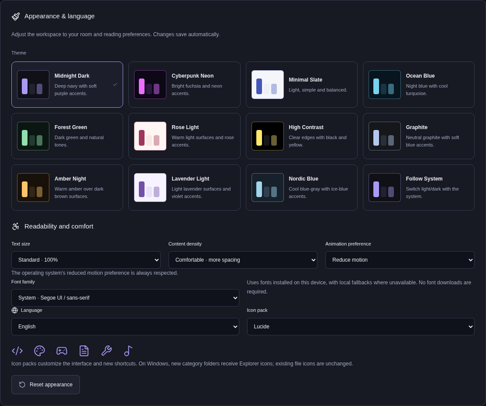</td>
    <td>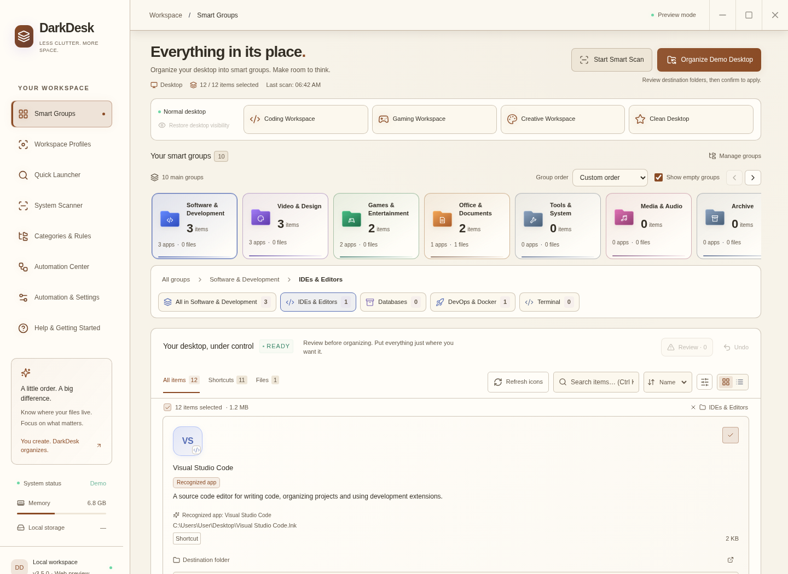</td>
  </tr>
</table>

### Clearer groups, real folder colors

See why each item was grouped, filter uncertain matches for review, and open a subgroup without losing its parent context. Sort groups by name or item count and hide empty groups when you want a shorter overview. Manual choices remain in control; custom rule previews show matching items before saving.

Choose **Gradient**, **Solid**, **Outline**, **Pastel**, **Glass**, **Neon** or **Paper** folders independently from the application theme. Each group has its own color and glyph. In its editor, **Style for this folder** can override the global style or follow it; the same saved style powers previews and Windows folder artwork. Start with ten preset colors or choose custom HEX values and one of six gradient palettes. Saving a visual change updates existing DarkDesk-owned Windows folder icons automatically; **Apply to desktop folders** is also available for an explicit refresh. The app retains 360 bundled preset icons and generates matching custom artwork locally. Original application logos are preserved. See the [folder appearance guide](docs/FOLDER-APPEARANCE.md) for existing folders, skipped custom icons, and undo behavior.

<table>
  <tr>
    <td align="center"><strong>Three folder styles</strong></td>
    <td align="center"><strong>Your own colors and gradients</strong></td>
  </tr>
  <tr>
    <td>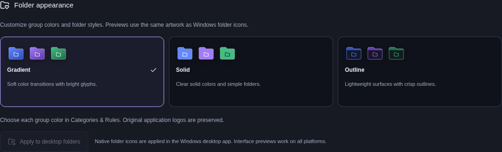</td>
    <td>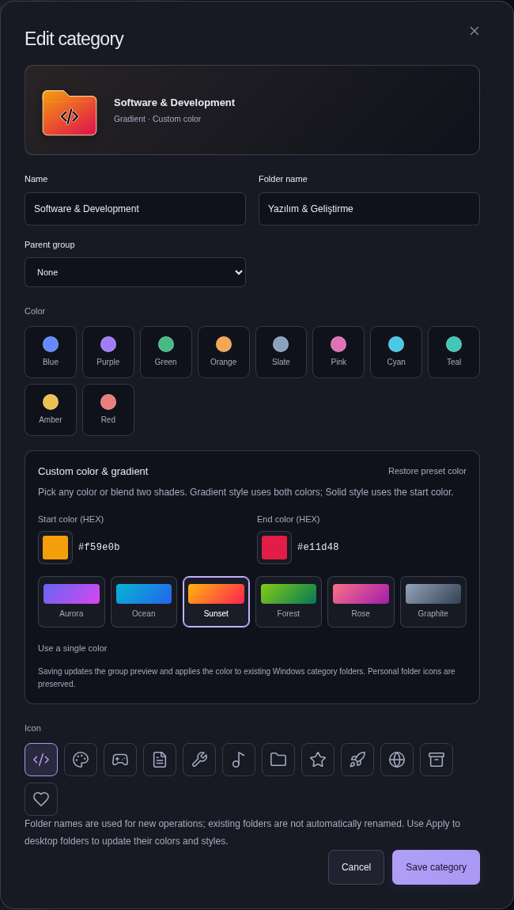</td>
  </tr>
</table>

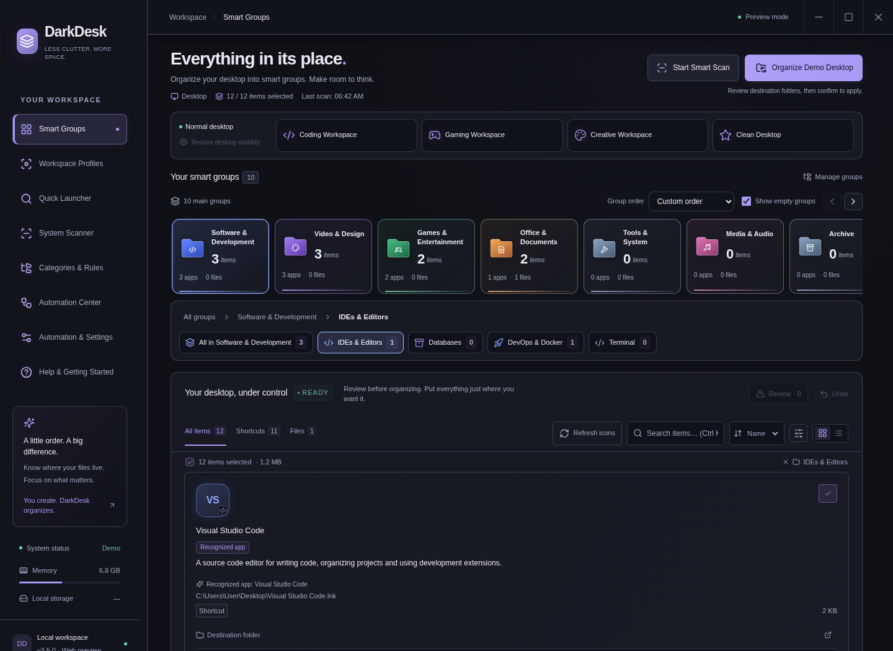

### Your daily tools, close at hand

Open **Desktop Widgets** to show a CPU/RAM monitor, sticky note, or to-do list. Collapse panels from their headers; expanded panels use compact bounds and the system monitor includes per-core samples and a RAM bar. Drag each panel by its header; notes, tasks, enabled widgets, and positions survive a normal restart. Windows and macOS desktop placement uses native adapters. If attachment is unavailable, DarkDesk identifies the panel as a floating window. Linux uses floating widgets. The browser preview can demonstrate notes and tasks inside the page, while native CPU/RAM data requires Electron.

**Startup Manager** lists Windows Run and Startup-folder entries. Supported current-user entries can be disabled and re-enabled using startup approval flags; original commands and files stay intact. Machine-wide entries are read-only. This controls the next sign-in and does not stop an app that is already running, or manage every service and scheduled task.

**Focus Analytics** starts disabled. When enabled on Windows or macOS, it samples foreground and eligible open applications about every 15 seconds, excluding idle periods of 60 seconds or more, lock, and suspend. The dashboard separates foreground attention, open-app time, and profile time. Open-app time can overlap and is not a sum of process lifetimes. Data stays local for 90 days; use **Clear history** to remove it. See the [widgets, startup, and analytics guide](docs/PRODUCTIVITY.md) for scope and platform details.

|                             Notes and tasks in the browser preview                             |                                 Analytics consent and empty dashboard                                 |
| :--------------------------------------------------------------------------------------------: | :---------------------------------------------------------------------------------------------------: |
| 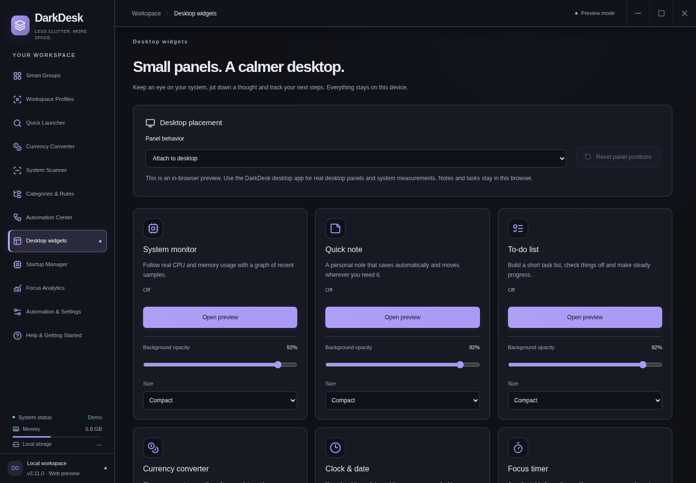 | 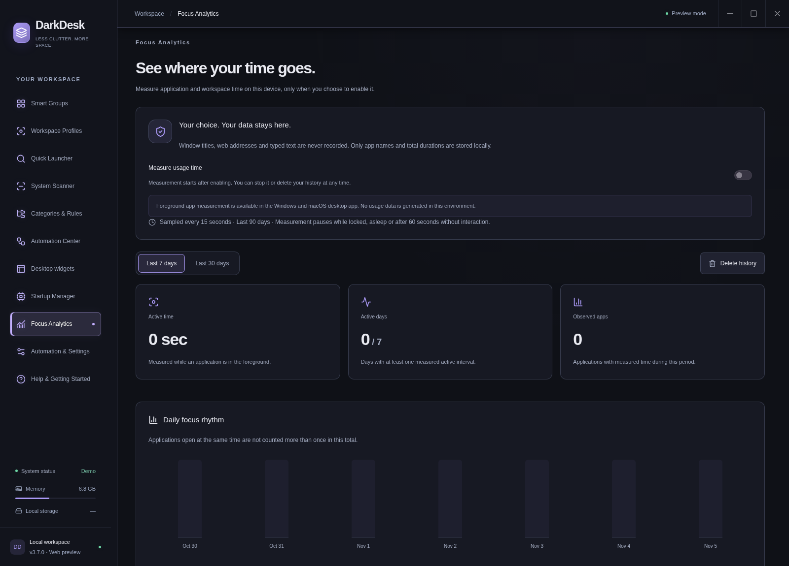 |

These screenshots show the real browser preview. Desktop attachment, startup control, and usage measurement require the native app; no sample system metrics or usage records are displayed.

### Descriptions that explain the app

Cards use your saved manual description first, then Windows **File Description** metadata for supported executable or shortcut targets, then the offline dictionary. The dictionary includes **Advanced IP Scanner**, **BCUninstaller**, **Any Command**, **DaVinci Resolve**, **VMware Workstation**, **FlutterFlow**, and other common apps. Unrecognized items receive a name/type hint or a prompt to add a description from their details panel. Each description shows its source. Metadata and filename matches do not independently verify a publisher or app identity.

### A personal widget workspace

Choose System Monitor, Sticky Note, To-do List, Currency Converter, Clock & Date and Focus Timer. Each widget has independent background opacity and size presets; native windows also resize from their edges. Windows note/task editors stay in focusable windows for reliable typing. System panels separate Overview, CPU, Memory and Disk views, with real per-core usage, clear utilization bars and process memory. Scrollbars are hidden while longer notes and lists remain accessible; background blur is fixed rather than configurable. See [widget controls and platform behavior](docs/PRODUCTIVITY.md).

### AI tools and pinned favorites

The **AI & Intelligent Tools** group includes assistants, coding tools, local models and AI media tools. Claude, ChatGPT, Cursor, Windsurf, Ollama, LM Studio and other recognized tools route here automatically; custom rules and manual choices keep precedence. Existing preferences migrate once, preserving user-defined groups.

Quick Launcher has **All / Favorites** views for both applications and commands. Pin the selected result with **Ctrl+D**, or switch views with **Ctrl+1 / Ctrl+2**. Pinning a system command never runs it and destructive commands retain their confirmation.

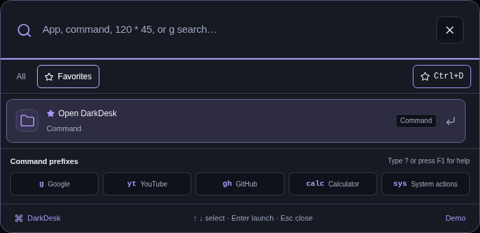

### Folder customization and custom scan locations

Open **Categories & Rules**, select **Customize** on a category and choose a palette, style and icon. **Save and apply to Desktop** saves those preferences, creates the selected Windows category folder if necessary, and applies its physical icon. The editor shows the target Desktop path. Existing personal icon metadata remains protected; an unsuccessful apply is reported rather than presented as a successful color change. The simpler **Save category** action keeps interface preferences and refreshes existing owned folders. Global folder styles are in the expandable **Global folder theme** section.

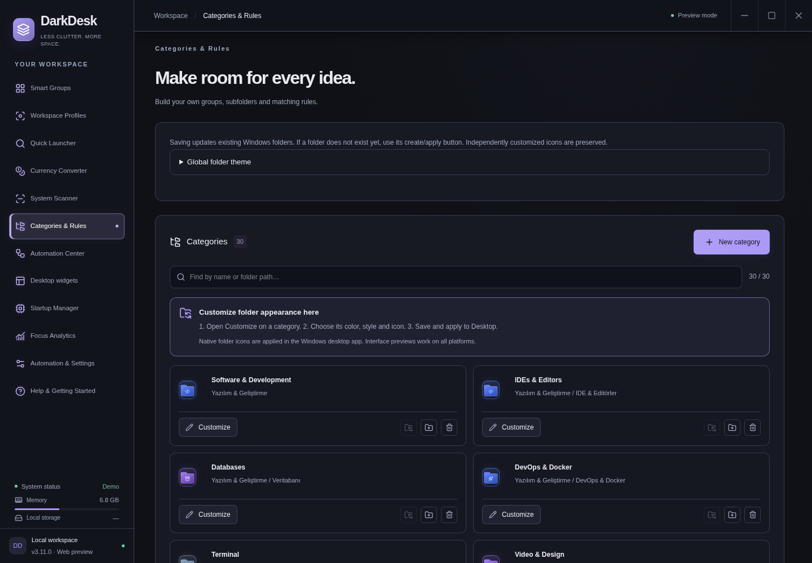

In **System Scanner**, use **Choose location and scan** to select a local application folder. The source is independent of Desktop, installed apps and Downloads. Discovery is read-only, observes depth/noise filters and indexes supported executables/shortcuts; organizing those results creates Desktop shortcuts instead of moving program files. Canceling the picker leaves the existing source unchanged. Custom results also enter Quick Launcher while indexed.

### Easy currency conversion

Open **Currency Converter** in the sidebar for amount/from/to controls, swap, refresh and copy, or add its desktop widget. The launcher remains available: type **50 USD to TRY**, **100 EUR**, **USD to TRY**, or **EUR**. Omitting the amount means one unit. An omitted target uses TRY in Turkish and USD in English. Frankfurter supplies institutional reference rates with their published date; these are not streaming market quotes. The app requests one fixed USD-based feed, without sending the typed amount, search query, filenames or app inventory. Quotes refresh after one hour; a valid cached snapshot can be used offline for up to seven days and is labeled as offline. Unsupported currencies and unavailable rates show an explicit error, not an invented number. Existing local unit conversions remain available.

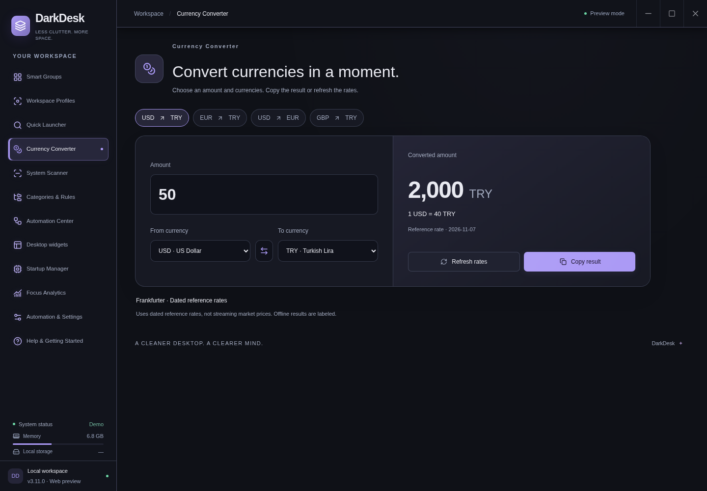

_Interface preview with a controlled sample reference rate._

### More than app search

Type `120 * 45`, `calc 120 * 45`, or `10 km to m`, then press **Enter** to copy the result. Search the web with `g <query>`, `yt <query>`, or `gh <query>`. On an application result, **Tab** or **Ctrl+K** opens favorites, file location, and Windows administrator actions. An empty query puts your three most-used observed items first and suggests frequent successful commands. Type `?`, press Space, or use **F1** for the prefix guide. `sys lock`, `sys mute`, `sys empty trash`, and `sys shutdown` route to the same native actions and confirmations as command results.

Files organized by DarkDesk remain available through verified operation history, including after Undo or a restart. Their favorites and launch counts retain the same identity. Missing or changed managed outputs are excluded until they can be verified; recovery does not recursively scan other folders.

Windows system commands include Lock Screen, Mute / Unmute and Volume controls, Empty Recycle Bin, and Shut Down. The last two require a separate confirmation. Read the [launcher guide](docs/LAUNCHER.md) for examples, keyboard controls, and platform support.

|                            Calculate and convert                             |                                        Item actions                                        |
| :--------------------------------------------------------------------------: | :----------------------------------------------------------------------------------------: |
| 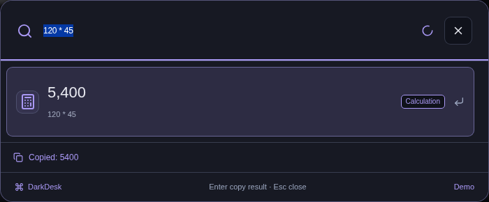 | 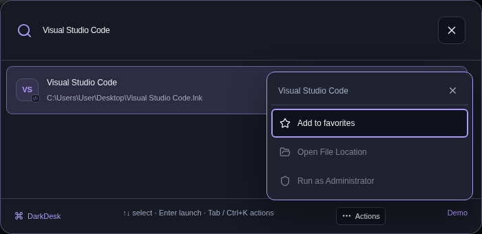 |

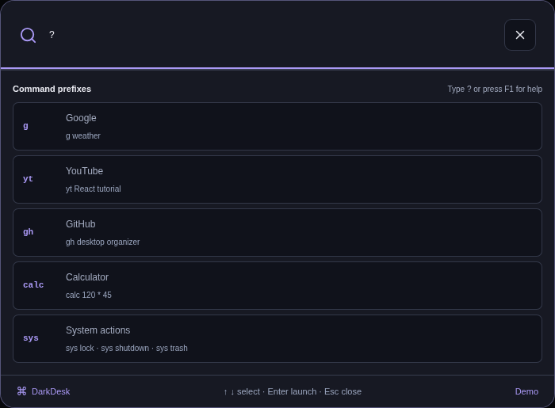

**Estimated usage** never needs to be blank: recorded DarkDesk launches take priority; otherwise a category-based label provides context. Estimates are not measurements of Windows-wide activity or time spent in an app.

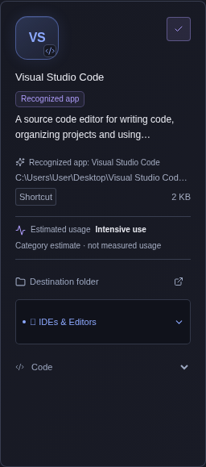

<details>
<summary><strong>More previews: launcher, profiles, and organization</strong></summary>

Screenshots show the English browser preview with sample data. Physical destination folder names are independent of the interface language; the app also supports Turkish.

|                                   Quick launcher                                    |                           Focus profiles                            |
| :---------------------------------------------------------------------------------: | :-----------------------------------------------------------------: |
|             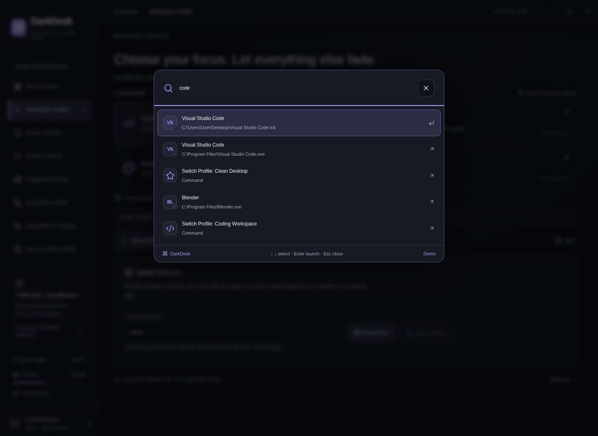              |         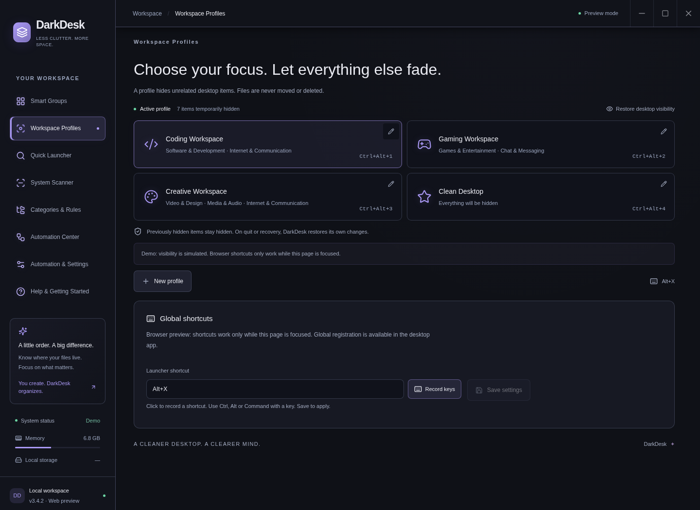          |
|                             **Preview before applying**                             |                        **Review the result**                        |
| 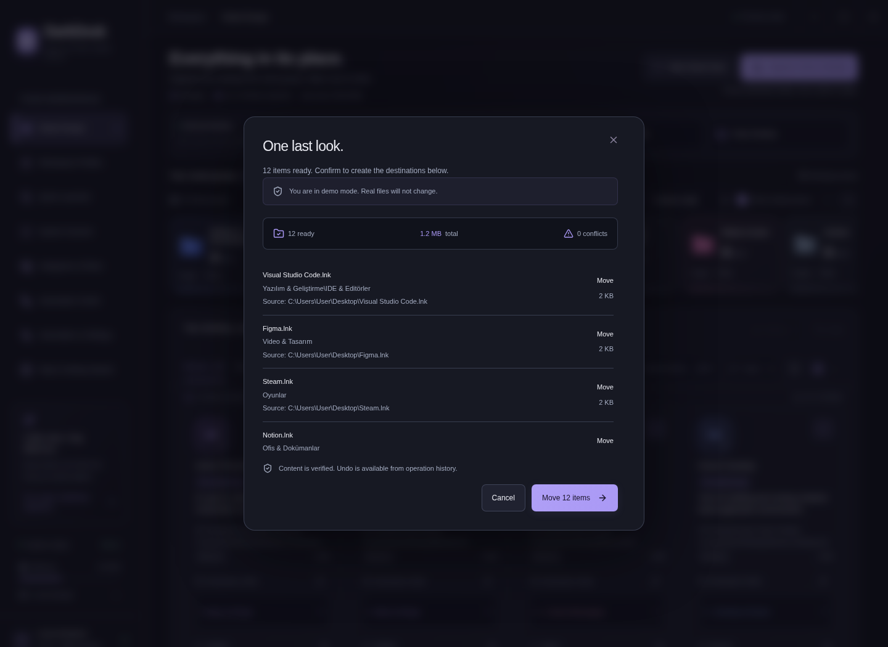 | 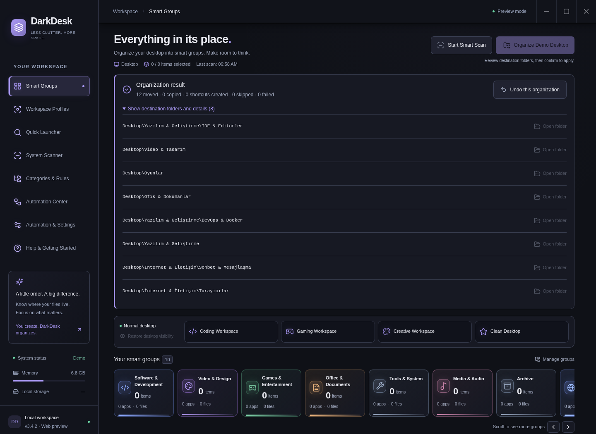 |

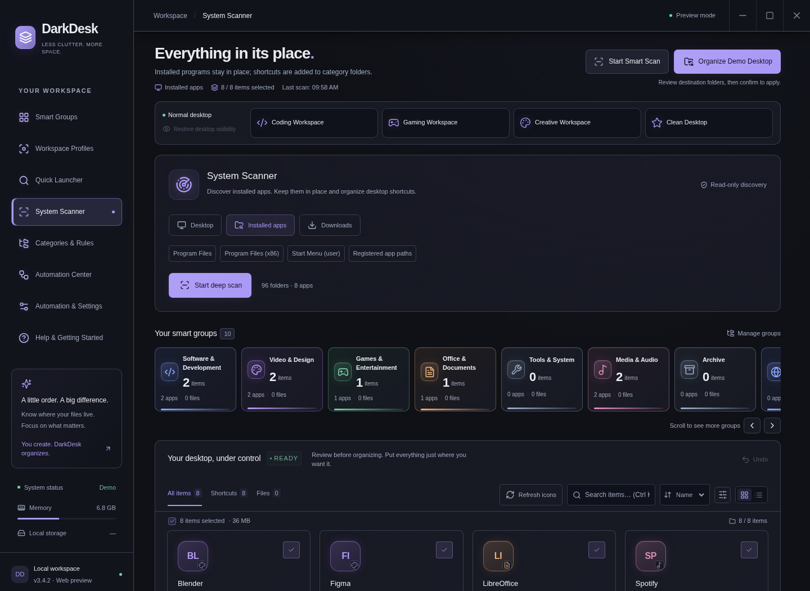

</details>

## Designed for your desktop

**Windows is the primary platform.** DarkDesk uses the operating system's desktop location, including OneDrive-redirected desktops. The app stays available in the system tray after you close the window; use **Quit** from the tray to exit fully.

Linux supports desktop operations, application discovery, `.desktop` shortcuts, and published AppImage/DEB packages. Windows Setup and Linux AppImage support in-app updates; DEB and Portable packages update manually. Native folder-icon customization and startup controls are Windows-specific. macOS supports the new widget windows and opt-in analytics, but deep application scanning, startup management, profile visibility, and signed/notarized distribution are not currently provided. Desktop widget attachment depends on the current desktop session; floating mode remains available when attachment fails.

Global shortcuts depend on the operating system and other apps. DarkDesk lets you record another combination when a shortcut is already taken. Native icons and executable metadata depend on the files and permissions available on your machine.

## Privacy and file protection

Scanning, classification, and app descriptions run locally. Desktop organization requires no account or cloud AI service, and file lists are not uploaded. Release checks and downloads use GitHub; update access is documented in the [update guide](docs/UPDATES.md). A web-search prefix sends its query to the chosen provider only when you activate that result. Calculations and unit conversions run locally. Analytics is off until you opt in; it stores application names, hashed identities, and aggregate durations locally, without window titles, document names, browser URLs, or raw executable paths. Widget notes and tasks are also stored on this device.

- **Review first:** manual organization uses an explicit preview and confirmation. Background file routing runs only when you enable its automation rules.
- **No overwrites:** conflicting destinations are skipped. Copies are verified before move sources are removed.
- **Recoverable history:** operations keep a persistent log. Undo checks file contents and stops when another change would make reversal unsafe.
- **Restricted native bridge:** the renderer has no Node.js access; native operations use a limited IPC interface with isolation and sandboxing.

Undo is a recovery aid, not a backup. Multi-file operations cannot be atomic across the whole operating system, and external changes or interruptions can require manual recovery. See [organization and recovery](docs/ORGANIZATION.md) for details.

## Run from source

Use **Node.js 24 LTS** (Node.js 22.12+ is supported), npm, and a graphical desktop session.

```sh
git clone https://github.com/Huseyinhk61/DarkDesk.git
cd DarkDesk
npm ci
npm run desktop
```

Run these commands **inside the folder containing `package.json`**. Running npm from your user home folder causes an `ENOENT` / missing `package.json` error.

Without Git, [download the source ZIP](https://github.com/Huseyinhk61/DarkDesk/archive/refs/heads/main.zip), extract it, and open a terminal inside `DarkDesk-main`. On Windows, `DarkDesk-Baslat.cmd` can install dependencies and start the app from that folder.

To preview the interface in a browser:

```sh
npm run dev
```

Open the address printed by Vite. **Browser mode uses sample data and cannot organize real desktop files.** Use `npm run desktop` for native operations.

### Build and test

| Command                                | Purpose                                                                                                   |
| :------------------------------------- | :-------------------------------------------------------------------------------------------------------- |
| `npm run build`                        | Build the production interface.                                                                           |
| `npm test`                             | Run service, model, and settings tests with temporary files.                                              |
| `npm run test:e2e`                     | Run Chromium interface scenarios with Playwright.                                                         |
| `npm run test:desktop`                 | Exercise real Electron IPC against an isolated desktop.                                                   |
| `node scripts/widget-native-smoke.cjs` | Check real widget windows, their restricted IPC, persistence, and native bindings in an isolated fixture. |
| `npm run check`                        | Run service tests, production build, and browser tests.                                                   |
| `npm run dist:win`                     | Build Setup and Portable EXEs into `release/`.                                                            |
| `npm run dist:linux`                   | Build a Linux AppImage into `release/`.                                                                   |

Install Chromium once with `npx playwright install chromium` before browser tests. Headless Linux requires `xvfb-run -a npm run test:desktop` for native tests. The [validation report](docs/VALIDATION.md) records test results and platform-specific limits; cross-built EXEs have been checked for integrity, but a live Windows install/upgrade has not been verified in the Linux development environment.

## Documentation

- [Windows setup and troubleshooting](docs/WINDOWS.md)
- [GitHub push and release troubleshooting](docs/GITHUB-TROUBLESHOOTING.md)
- [Installation, in-app updates, and publishing](docs/UPDATES.md)
- [Organization, icons, and recovery](docs/ORGANIZATION.md)
- [Themes, readability, and everyday use](docs/USABILITY.md)
- [Folder colors, styles, and existing Windows folders](docs/FOLDER-APPEARANCE.md)
- [Native icons, app details, and shortcuts](docs/DESKTOP-UX.md)
- [Calculator, web search, favorites, and system commands](docs/LAUNCHER.md)
- [Widgets, startup management, and focus analytics](docs/PRODUCTIVITY.md)
- [Profiles, launcher, and automation architecture](docs/ECOSYSTEM.md)
- [Validation report](docs/VALIDATION.md) · [Changelog](CHANGELOG.md)
- [Repository publishing and About settings](docs/REPOSITORY.md)

## Contribute

Read the [contribution guide](CONTRIBUTING.md), then open an [issue](https://github.com/Huseyinhk61/DarkDesk/issues) with your app version, operating system, reproduction steps, and relevant errors. Remove personal paths and credentials from logs or screenshots before sharing them.

**License:** no license file has been added yet. Public source availability does not grant a separate open-source license.
