<div align="center">
  
  <br /><br />
  <a href="https://github.com/Huseyinhk61/DarkDesk/actions/workflows/ci.yml"></a>
  
  
  
  <br /><br />
  <strong>Odağını seç. Uygulamalarını bul. Düzeni koru.</strong>
  <p>Dosya ve kısayollarını analiz eden, gerçek klasörlere düzenleyen,<br />her adımda kontrolü sana bırakan yerel masaüstü uygulaması.</p>
  <a href="#-hızlı-başlangıç">Başlangıç</a> ·
  <a href="#-neler-yapabilirsin">Özellikler</a> ·
  <a href="docs/WINDOWS.md">Windows rehberi</a> ·
  <a href="https://github.com/Huseyinhk61/DarkDesk/actions/workflows/windows.yml">Windows paketi</a> ·
  <a href="https://github.com/Huseyinhk61/DarkDesk/issues">Hata bildir</a>
  <br /><br />
  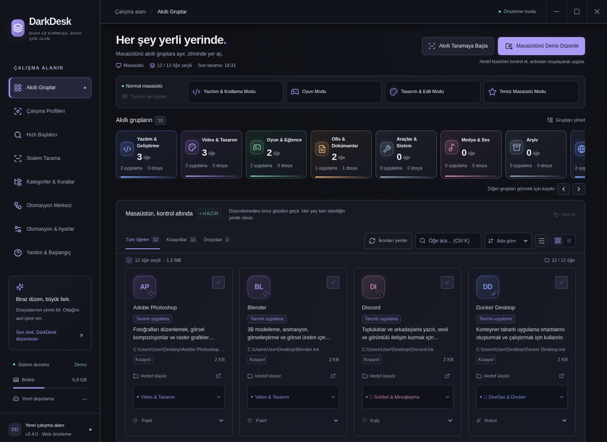
  <sub>Web önizlemesinden gerçek ekran görüntüsü. Örnek veriler kullanılır.</sub>
</div>

## ✦ Neler yapabilirsin?

| Özellik                       | Nasıl çalışır?                                                                                                                                                              |
| :---------------------------- | :-------------------------------------------------------------------------------------------------------------------------------------------------------------------------- |
| **Akıllı kategoriler**        | Yazılım, tasarım, oyun, ofis ve sistem araçları için dosya adı/uzantısı analizi. Windows `.lnk` hedefleri de değerlendirilir.                                               |
| **Gerçek masaüstü düzenleme** | Seçtiğin öğeler, işletim sisteminin masaüstü konumunda oluşturulan gerçek klasörlere taşınır veya kopyalanır. OneDrive ile yönlendirilmiş masaüstü için OS yolu kullanılır. |
| **Önce önizleme**             | Her öğenin hedefini, toplam boyutu ve isim çakışmalarını onaydan önce gör. Çakışmalar atlanır; var olan dosyaların üzerine yazılmaz.                                        |
| **Geri alınabilir işlemler**  | Kalıcı işlem günlüğü, SHA-256 içerik kontrolü ve son işlemden başlayarak geri alma. Uygulamayı kapatıp açtığında da geçmiş korunur.                                         |
| **Sana göre kategoriler**     | Dosya kartından hedef grubu değiştir. Tercihin sonraki taramalarda hatırlanır.                                                                                              |
| **Canlı masaüstü takibi**     | Dosyalar eklendiğinde/kaldırıldığında liste otomatik yenilenir. Onayın olmadan taşıma yapılmaz.                                                                             |
| **Hızlı çalışma alanı**       | Arama, kategori ve dosya türü filtreleri, ad/boyut/tarih sıralaması, kart/liste görünümü, görünen öğeleri toplu seçme.                                                      |
| **Kalıcı ayarlar**            | Taşı/kopyala seçimi, canlı takip, hariç tutulacak uzantılar ve kategori tercihleri bu cihazda saklanır.                                                                     |
| **Yerel ve hesapsız**         | Dosya işlemleri için hesap, API anahtarı veya bulut servisi gerekmez. Sonuç bildiriminden tek tıkla geri alınabilir.                                                        |

## 🚀 3.4: doğru kaynak taraması, daha çok kişiselleştirme ve güncelleme

- **Masaüstü / Yüklü uygulamalar / İndirilenler:** Sekme ve tarama düğmesi aynı kaynağı kullanır; geçişte eski filtre/sonuçlar diğer kaynağa taşınmaz.
- **11 renk paleti + Sistem Teması:** Graphite, Amber Night, Lavender Light ve Nordic Blue eklendi.
- **4 yazı tipi seçeneği:** Sistem, okunaklı, klasik ve monospace yerel font aileleri; kurulu olmayan font için yerel yedek kullanılır.
- **5 ikon paketi:** Lucide, Tabler, Minimalist, Rounded ve Duotone; yeni klasörler için toplam 60 native ICO.
- **10 ana grup / 25 toplam grup:** İnternet & İletişim, Eğitim & Okuma, Finans & İş ve alt grupları. Yerel açıklama kataloğu 91 uygulama içerir.
- **Alt+X:** Yeni kurulumların varsayılan hızlı başlatıcı tuşu. Kayıtlı özel atamalar korunur.
- **Uygulama içi güncelleme:** Kurulu Windows NSIS sürümü yeni sürümü denetler, bildirim gösterir ve kullanıcı indirme/yeniden başlatma düğmelerini seçer.

[**Windows EXE sürümleri →**](https://github.com/Huseyinhk61/DarkDesk/releases/latest) · [**Kurulum ve güncelleme rehberi →**](docs/UPDATES.md)

GitHub Windows iş akışı yeni sürüm numaralı `main` güncellemelerinde Setup/Portable EXE, `latest.yml`, blockmap ve özetleri üretip Releases'a yayınlar. İndirme bağlantısı başarılı yayın sonrası kullanılabilir. GitHub sürüm kaynağı uygulamadan erişilebilir olmalıdır; gizli depo varlıkları için kullanıcıya bir erişim anahtarı gömülmez.

<p align="center">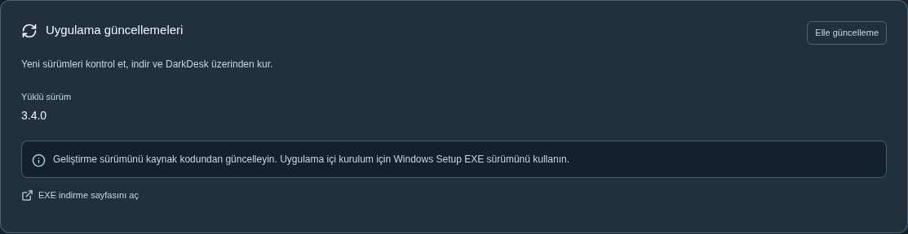</p>

## 🛠️ 3.3: çalışan düzenleme, özgün ikonlar ve uygulama açıklamaları

Klasör ikonu veya tarih ayarı başarısız olduğunda gerçek dosya taşımanın durması düzeltildi. Düzenleme sonunda taşınan/kopyalanan öğeler, oluşturulan kısayollar, atlanan dosyalar ve uyarılar ayrı gösterilir. **Hedef klasörü aç** ve **Bu düzenlemeyi geri al** düğmeleri sonucu incelemeyi kolaylaştırır.

- **Özgün ikonlar:** Windows `.lnk` ikon kaynağı/indeksi, executable kaynakları ve `.url` yerel ikonları okunur. Oluşturulan uygulama kısayolları varsayılan olarak kendi logosunu korur. Geçici hatalarda **İkonları yenile** kullanılabilir.
- **Ne işe yarar?** 82 uygulamalık yerel katalog Türkçe/İngilizce açıklama sağlar. Bilinmeyen öğelerde dosya türü veya kategori tahmini açıkça belirtilir. Dosya içeriği veya internet servisiyle AI analizi yapılmaz.
- **Daha kullanışlı masaüstü:** Kısa başlık/profil şeridi ve kategori kartları koleksiyona yer açar; Spotlight opak paneli arka plan yazılarının karışmasını önler. Metin boyutu, temalar ve klavye erişimi korunur.

<p align="center">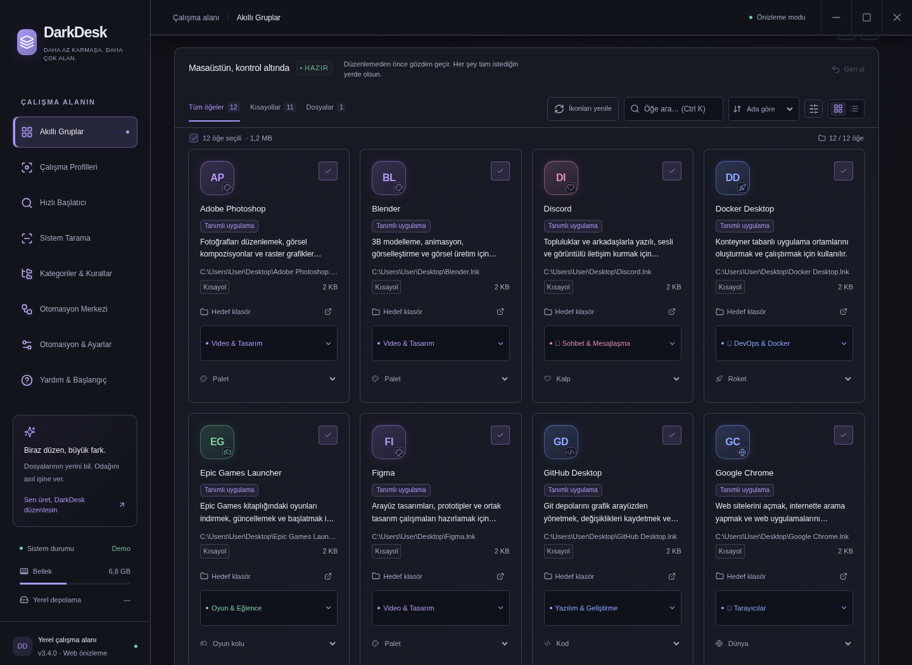</p>

[**Klasörleme ve ikon sorunlarını giderme →**](docs/ORGANIZATION.md)

## 🎨 3.2: daha okunabilir, masaüstüne uyumlu

Ocean Blue, Forest Green, Rose Light ve Yüksek Kontrast eklendi. **Sistem Teması** işletim sisteminin açık/koyu seçimini izler; toplam 7 renk paleti ve sistem seçeneği bulunur.

- %100 / %115 / %130 metin boyutu, rahat/sıkışık kart yoğunluğu ve hareket azaltma.
- Daha büyük seçim alanları, belirgin klavye odağı ve ana içeriğe geç bağlantısı.
- Diyaloglarda klavye ve ekran okuyucu için arka plan yalıtımı; odak ve hata mesajları korunur.
- Pencere boyutu/konumu hatırlanır; monitör değişince pencere görünür alana alınır.
- İlk kez kullananlar için internet gerektirmeyen **Yardım & Başlangıç** ekranı.

|              Ocean Blue              |                 Forest Green                 |
| :----------------------------------: | :------------------------------------------: |
| 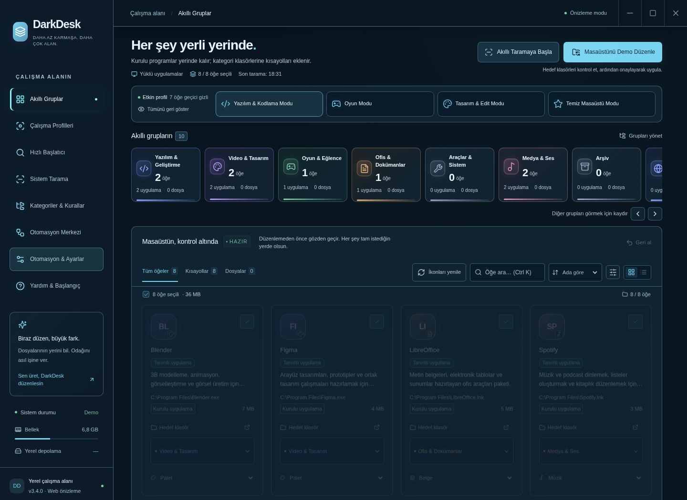 |   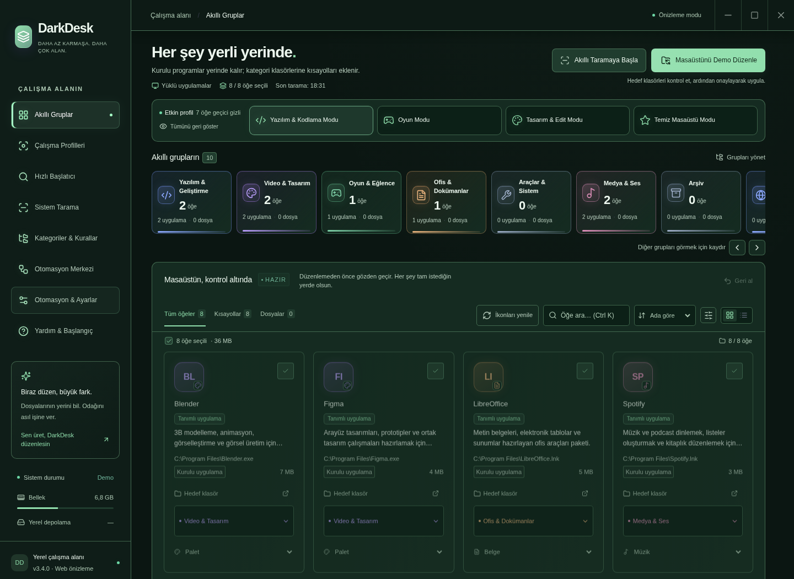    |
|              Rose Light              |               Yüksek Kontrast                |
| 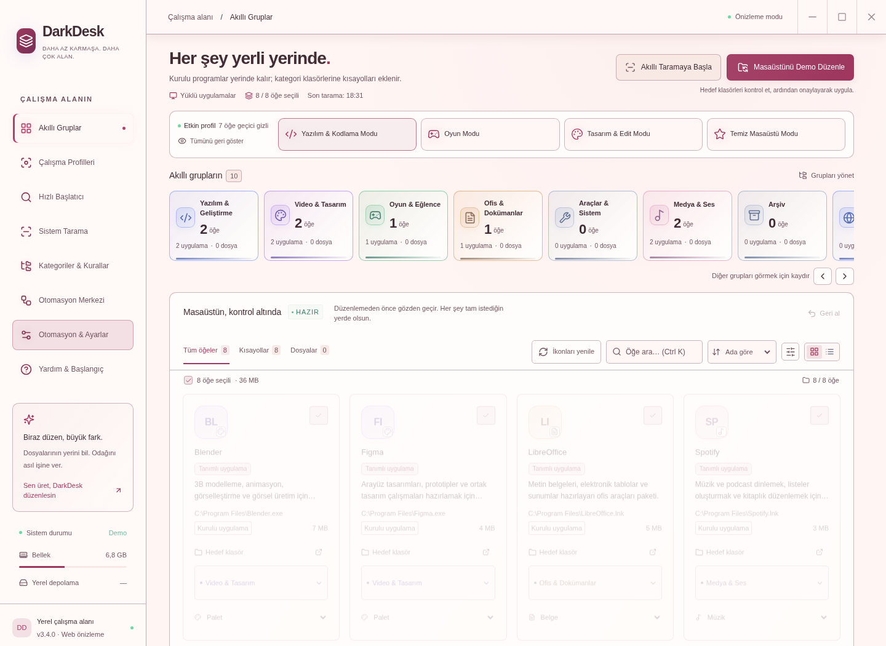  | 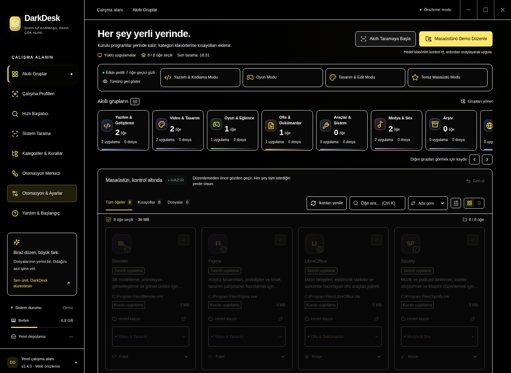 |

[**Kullanım rehberi →**](docs/USABILITY.md)

## ✨ 3.1: yerel ikonlar ve daha net çalışma alanı

- **Orijinal uygulama ikonları:** `.exe` ve `.lnk` ikonları Electron üzerinden okunur; bulunamadığında kategori ikonu kullanılır.
- **Ayrıntı paneli:** Kartın ikonuna veya adına tıklayarak boyut, tarihler, varsa açıklama/üretici ve DarkDesk üzerinden son başlatma zamanını gör.
- **Sabit pencere düzeni:** Başlık çubuğu ve sidebar yerinde kalır; ana içerik kayar. Büyük pencere kontrolleri ve daha belirgin kategori vurguları.
- **Tuşa basarak kısayol atama:** Profil ekranında veya ayarlarda kombinasyon kaydet. Çakışan yeni atama reddedilirken çalışan kısayollar korunur.

[**İkon, bilgi paneli ve kısayol rehberi →**](docs/DESKTOP-UX.md)

<p align="center">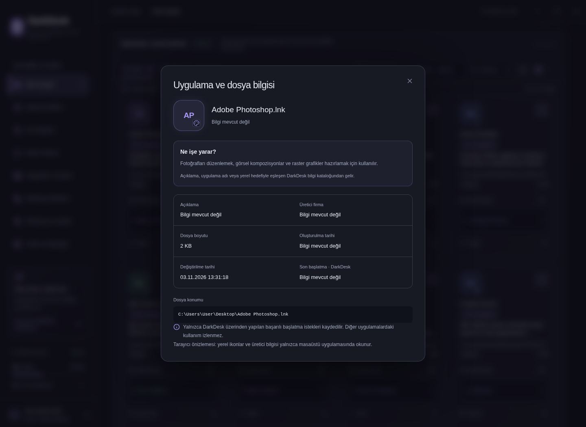</p>

## 🧭 3.0: çalışma alanından ekosisteme

| Yetenek                  | Davranış                                                                                                               |
| :----------------------- | :--------------------------------------------------------------------------------------------------------------------- |
| **Odak profilleri**      | Kodlama, Oyun, Tasarım, Temiz Masaüstü; global kısayollar ve özgün nitelikleri koruyan gerçek OS gizleme/geri yükleme. |
| **Spotlight**            | Alt+X, fuzzy arama, klavye navigasyonu, indekslenen dosyaları açma ve güvenli sistem komutları.                        |
| **Arka plan otomasyonu** | Kullanıcının etkinleştirdiği arşiv ve Downloads kuralları; günlük, geri alma ve tekrar işleme koruması.                |
| **Yerel öneriler**       | Bilinmeyen adlara yerel anahtar kelime vektörleriyle kategori önerisi; model indirmesi veya ağ isteği yok.             |
| **Regex & alt gruplar**  | RE2JS ile güvenli regex; IDE, DevOps, Veritabanı, Ağ, Sürücüler ve Kurulumlar gibi hazır alt kategoriler.              |
| **Sürükle-bırak**        | Kartı kategoriye bırak; OS’den Desktop/Downloads dosyaları için onaylı önizleme.                                       |
| **Sistem tepsisi**       | X ile arka plana geç; profilleri, başlatıcıyı ve düzenlemeyi tepsi menüsünden yönet.                                   |

[**3.0 kullanım ve mimari rehberi →**](docs/ECOSYSTEM.md)

<div align="center">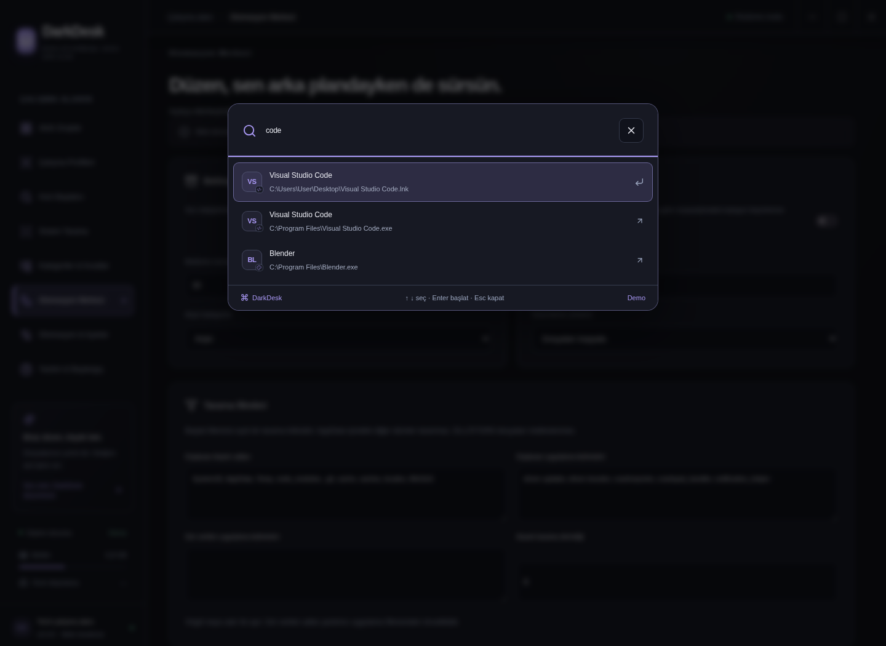</div>

## 🎨 Görünümünü seç

<table>
  <tr><td align="center"><strong>Cyberpunk Neon · Lucide</strong></td><td align="center"><strong>Minimal Slate · English · Tabler</strong></td></tr>
  <tr><td>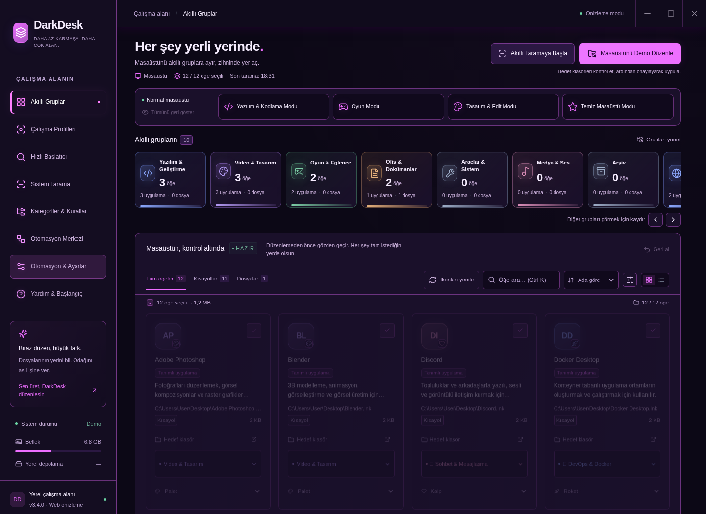</td><td>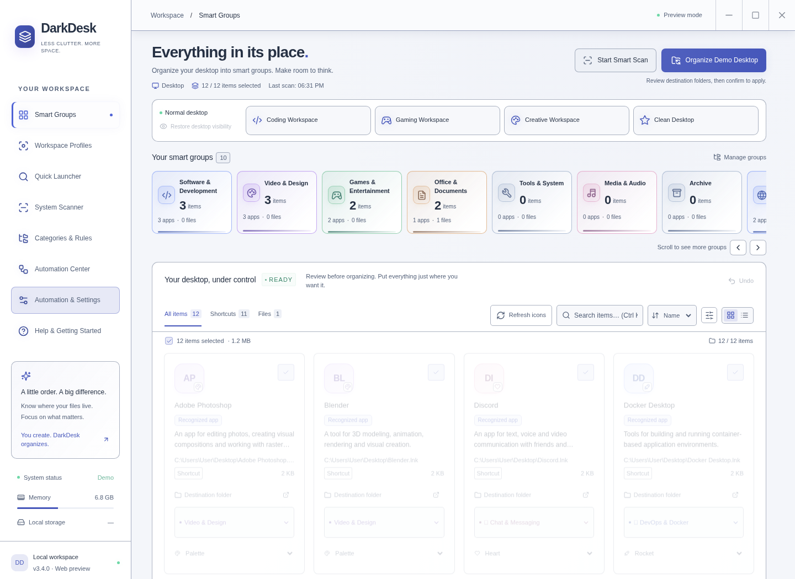</td></tr>
</table>

Tema, dil ve ikon paketi **Otomasyon & Ayarlar → Görünüm & dil** bölümündedir. Her kategorinin ikonunu **Kategoriler & Kurallar**, tek bir öğenin ikonunu dosya kartından seçebilirsin. Mevcut dosyaların işletim sistemi ikonları değiştirilmez. Windows dışındaki platformlarda fiziksel klasör ikonlandırma desteklenmez; arayüz ikonları çalışır.

## 🔎 Derin tarama ve özel gruplar

**Sistem Tarama → Derin taramayı başlat** ile uygulamaları keşfet. Masaüstü ve yüklü uygulamalar arasında geçiş yapabilirsin. Program Files’taki `.exe` dosyaları hiçbir zaman taşınmaz veya silinmez: onaylanan işlem masaüstündeki kategori klasörlerine `.lnk` oluşturur. Geri alma yalnızca oluşturulan kısayolları kaldırır.

**Kategoriler & Kurallar** bölümünde yeni bir grup veya alt grup ekle, klasör adını/ikonunu seç. Örneğin `Yazılım & Geliştirme / Projeler / Müşteri` gibi gerçek alt klasörler oluşturulabilir. Adında `game` geçenleri Oyunlar’a veya `.pdf` uzantılı dosyaları özel bir gruba eşleyen kurallar tanımlayabilirsin. Kurallar yukarıdan aşağı değerlendirilir; manuel atamalar kurallardan önceliklidir.

- Tarama salt okunurdur; yönetici yetkisi istemez. Erişilemeyen alanları raporlayarak devam eder.
- Sembolik bağlantılar, kurulum/kaldırma yardımcıları ve önbellek dizinleri atlanır. Aynı hedefe giden kısayollar tekilleştirilir.
- Kaynak sınırları: varsayılan 8, azami 12 dizin derinliği, 100.000 dizin ve 10.000 sonuç. Sınıra ulaşılırsa kısmi sonuç uyarısı gösterilir. Tek onayda en fazla 5.000 öğe işlenir; kartlar 48’lik gruplar halinde yüklenir.
- Windows kayıt defteri yalnızca okunur. Linux’ta `/usr/share/applications`, kullanıcı uygulamaları ve `/opt` taranır; `.desktop` kısayolları oluşturulur. macOS derin taraması şu anda desteklenmez; masaüstü taraması kullanılabilir.
- Tarama sonuçlarının tamamı her makinedeki bütün uygulamaları garanti etmez; erişim izinleri, özel kurulum yolları ve belirtilen sınırlar sonucu etkiler.
- Kategori silmek diskteki klasörleri/dosyaları silmez. Kategori veya klasör adı değiştirmek mevcut klasörleri yeniden adlandırmaz; değişiklik yeni işlemlerde kullanılır. Eski işlemler, kendi kayıtlı hedefleriyle geri alınabilir.

<div align="center">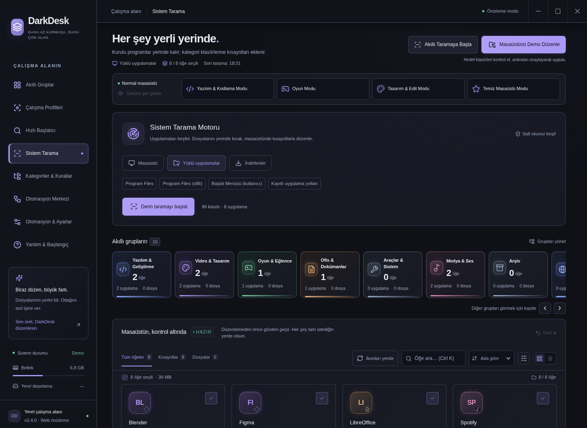<sub>Web demosunda örnek uygulamalar gösterilir. Gerçek tarama Electron’da çalışır.</sub></div>

## 🚀 Hızlı başlangıç

**Gerekenler:** [Node.js 24 LTS](https://nodejs.org/) ve grafik masaüstü ortamı. Node.js 22.12+ da desteklenir. Windows ilk hedef platformdur; Linux için paketleme komutu da bulunur.

### Git kurmadan

1. **[Kaynak kodu ZIP olarak indir](https://github.com/Huseyinhk61/DarkDesk/archive/refs/heads/main.zip)** ve **Tümünü ayıkla** ile çıkar.
2. Çıkan `DarkDesk-main` klasörünü aç. İçeride **`package.json`** dosyasını gördüğünden emin ol.
3. Windows Dosya Gezgini adres çubuğuna `powershell` yazıp Enter’a bas.
4. İstersen **`DarkDesk-Baslat.cmd` dosyasına çift tıkla**; ilk bağımlılık kurulumunu ve açılışı yapar. Terminalle ilerlemek için sırayla çalıştır:

```powershell
npm ci
npm run desktop
```

> Komutları kullanıcı ana klasöründe veya ZIP’in içinde çalıştırma. Kurulum hata verirse ikinci komuta geçmeden [Windows sorun giderme rehberine](docs/WINDOWS.md) bak. İlk kurulum Electron’u indirdiği için internet gerektirir.

### Git ile

```powershell
git clone https://github.com/Huseyinhk61/DarkDesk.git
cd DarkDesk
npm ci
npm run desktop
```

### Yalnızca arayüzü denemek için

```sh
npm run dev
```

Vite’ın terminalde gösterdiği adresi aç. **Web modu örnek verilerle çalışır; gerçek masaüstü dosyalarına erişmez.** Gerçek işlemler için `npm run desktop` kullanılır. Web modundaki pencere kontrolleri bu nedenle devre dışıdır.

## 🗂️ Düzenleme akışı

1. **Tara:** Masaüstündeki dosyalar ve kısayollar listelenir. Alt klasörlerin içi taranmaz.
2. **Gözden geçir:** Kategorileri düzenle, taşı/kopyala yöntemini ayarlardan seç, istenmeyen öğelerin seçimini kaldır.
3. **Önizle:** Hedefleri, toplam boyutu ve atlanacak çakışmaları gör.
4. **Onayla:** Yalnızca çakışmasız seçili dosyalar işlenir. İlerleme gösterilir.
5. **Geri al:** Kontrol panelindeki **Geri al** veya ayarlardaki işlem geçmişini kullan.

<div align="center">
  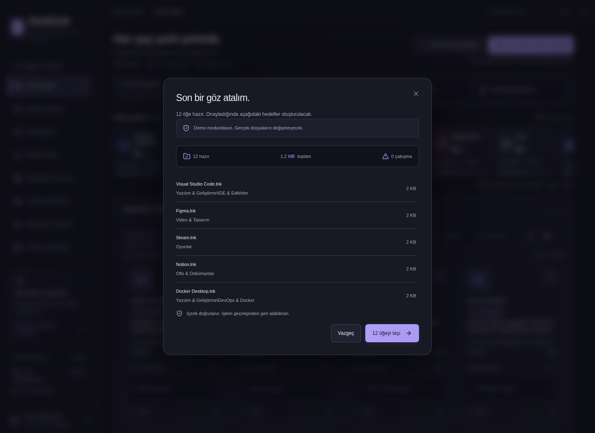
</div>

**Kısayol:** `Ctrl+K` / `⌘+K` aramaya odaklanır. `Esc` önizlemeyi kapatır. `Tab` ile diyalog içinde dolaşılabilir.

## 🛡️ Dosyaların nasıl korunuyor?

- Renderer’da Node.js erişimi kapalıdır; sandbox ve context isolation açıktır. Dosya işlemleri yalnızca sınırlı, ana pencereye ait IPC çağrıları üzerinden çalışır.
- İşlem öncesi kaynakların hâlâ aynı dosya olduğu kontrol edilir. Önizlemeler tek kullanımlıktır ve beş dakika sonra geçersiz olur.
- Kopyalar içerik özetiyle doğrulanır. Taşıma sırasında kaynak ancak doğrulama sonrasında kaldırılır.
- Geri alma, hedef içeriği değişmişse veya orijinal konumda başka bir dosya varsa durur. Kullanıcının yeni verisinin üzerine yazılmaz.
- Dosya işlemleri sıraya alınmaz; aynı anda ikinci değiştirme işlemi reddedilir. Uygulama tek örnek olarak çalışır.
- Gizli dosyalar, sembolik bağlantılar ve alt klasörler kapsam dışıdır. Hedef kategori klasörünün sembolik bağlantıyla değiştirilmesi reddedilir.
- Karttaki dış bağlantı düğmesi dosyayı Explorer/Finder’da **gösterir**; `.exe` veya kısayol çalıştırmaz.

İşlem geçmişi `history.json`, tercihler `settings.json` dosyasında, Electron kullanıcı verisi dizininde tutulur (Windows’ta genellikle `%APPDATA%\DarkDesk` veya geliştirme sürümünde `%APPDATA%\darkdesk`). Uygulama internet API’sine dosya listesi göndermez. Sisteminizin OneDrive gibi mevcut senkronizasyonu kendi ayarlarıyla çalışmaya devam eder.

**Sınırlar:** Çok dosyalı işlemler tüm işletim sistemi için atomik değildir. Güç kesintisi veya başka bir uygulamanın eşzamanlı değişikliği durumunda günlük üzerinden kurtarma denenir; sahipliği kesinleştirilemeyen hedeflerde otomatik silme yerine elle kontrol istenir. Bir yedekleme uygulamasının yerini tutmaz. Public/ortak masaüstü taranmaz. `.lnk` kopyalama mevcut kısayolu kopyalar; yeni kısayol üretmez. Kategori analizi yerel kurallara dayanır; bir çevrimiçi AI servisi kullanılmaz.

## 📦 Windows kurulum paketi

GitHub Actions içindeki **[Windows Installer](https://github.com/Huseyinhk61/DarkDesk/actions/workflows/windows.yml)** iş akışı:

- `DarkDesk-Setup-3.4.0.exe`: Kurulum sihirbazı ve masaüstü kısayolu.
- `DarkDesk-Portable-3.4.0.exe`: Kurulum gerektirmeyen sürüm.
- `SHA256SUMS.txt`: İndirilen dosyaları doğrulamak için özetler.

`main` dalına gönderilen güncellemeler Windows paketini otomatik oluşturur. Depo sahibi ayrıca **Run workflow** ile derlemeyi başlatabilir. Başarılı çalışmanın **Artifacts → DarkDesk-Windows** bölümünden paket indirilir. `v*` etiketi gönderildiğinde testlerden geçen paketler GitHub Releases’e eklenir. **İş akışı başarıyla tamamlanmadan hazır bir EXE bulunduğunu varsayma.**

Windows’ta kendin paketlemek için:

```powershell
npm run dist:win
```

Çıktılar `release/` klasörüne yazılır. Paketler şu aşamada kod imzalı değildir; Windows SmartScreen yayıncı uyarısı gösterebilir. Linux AppImage için `npm run dist:linux` kullanılabilir. macOS için imzalı/noter onaylı dağıtım henüz hazırlanmadı.

## 🧪 Geliştirme ve test

| Komut                     | İşlev                                                   |
| :------------------------ | :------------------------------------------------------ |
| `npm run dev`             | Vite ile web demosu                                     |
| `npm run desktop`         | Geliştirme sunucusu + Electron                          |
| `npm run desktop:preview` | Üretim derlemesini Electron’da aç                       |
| `npm run build`           | Üretim arayüzünü derle                                  |
| `npm test`                | Gerçek, geçici dosya sisteminde servis ve ayar testleri |
| `npm run test:e2e`        | Playwright ile tarayıcı akışları                        |
| `npm run test:desktop`    | İzole masaüstü üzerinde üretim Electron + IPC testi     |
| `npm run check`           | Servis testleri + derleme + tarayıcı testleri           |
| `npm run format`          | Kaynakları Prettier ile biçimlendir                     |

Tarayıcı testinden önce bir kez:

```sh
npx playwright install chromium
npm run check
```

Linux CI’de Electron testi için `xvfb-run -a npm run test:desktop` gerekir. Tüm testler geçici klasörler kullanır; test kullanıcısının gerçek masaüstüne dokunmaz. Playwright raporu `playwright-report/` altına yazılır.

Dağıtım bağımlılıklarında bilinen açık bulunmadı (`npm audit --omit=dev`). Tam araç zinciri denetiminde paketleyicinin geçişli geliştirme bağımlılıklarında orta seviye bildirimler bulunuyor; bunlar için eski bir paketleyici sürümüne otomatik düşürme yapılmadı.

**v3.4 doğrulaması:** Servis, tarama, kural/ayar göçü, dil sözlüğü ve Chromium testleri bulunur. Gerçek Electron testi izole masaüstünde taşıma/geri alma, uygulama keşfi, kısayol oluşturma/geri alma ve tema/dil/ikon kalıcılığını kontrol eder. Güncel yerel sonuçlar [test raporundadır](docs/VALIDATION.md). Windows’a özgü test ve EXE oluşturma ayrıca GitHub Actions üzerinde tanımlıdır; sonuçları üstteki canlı test rozetinden ve Actions sayfasından takip edilebilir.

<details>
<summary><strong>Proje yapısı</strong></summary>

```text
electron/
  main.cjs            Pencere, sınırlı IPC ve masaüstü takibi
  preload.cjs         Renderer için dar yetkili köprü
  service.cjs         Tarama, önizleme, SHA-256, işlem günlüğü ve geri alma
  settings.cjs        Kalıcı tercih depolama
  scanner.cjs         Program Files / Başlat Menüsü / kayıtlı uygulama keşfi
  folder-icons.cjs    Native klasör ikonları ve uygulama kısayolları
  runtime/            Profiller, görünürlük, kullanım, otomasyon ve seri koordinatör
shared/               Ortak kategori/tema katalogları, eşleştirme ve ayar doğrulama
src/
  components/         Sidebar, Header, CategoryGrid, ItemCard, Settings, PreviewModal
  App.jsx             Çalışma alanı ve işlem akışları
  service.js          Native köprü / etkileşimli web demosu
  styles.css          Duyarlı temel bileşen stilleri
  themes.css          Tema değişkenlerine bağlı bileşen stilleri
  usability.css       Metin ölçeği, yoğunluk, odak ve kontrast düzeni
  useDialog.js        Diyalog odağı ve arka plan yalıtımı
  locales/            Türkçe ve İngilizce JSON sözlükler (native tepsi dahil)
  preferences.jsx     Tema, dil, ikon ve kategori bağlamı
scripts/              Electron smoke testi ve ekran görüntüsü aracı
tests/                Playwright senaryoları ve izole Electron test giriş noktası
.github/workflows/    Windows/Linux testleri ve Windows EXE paketleme
```

</details>

## 🤝 Katkıda bulun

Bir hata bulduğunda [issue aç](https://github.com/Huseyinhk61/DarkDesk/issues): işletim sistemi, Node.js sürümü, yaptığın işlem ve hata metnini ekle. Kişisel dosya içeriklerini veya gizli bilgileri paylaşma. Geliştirmeden önce [katkı rehberine](CONTRIBUTING.md) göz at.

---

<div align="center"><sub>Daha sade bir masaüstü, daha net bir zihin. · <strong>DarkDesk</strong></sub></div>
