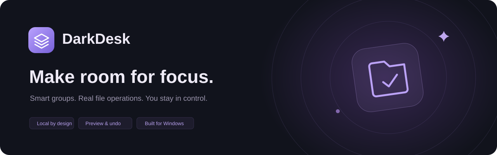
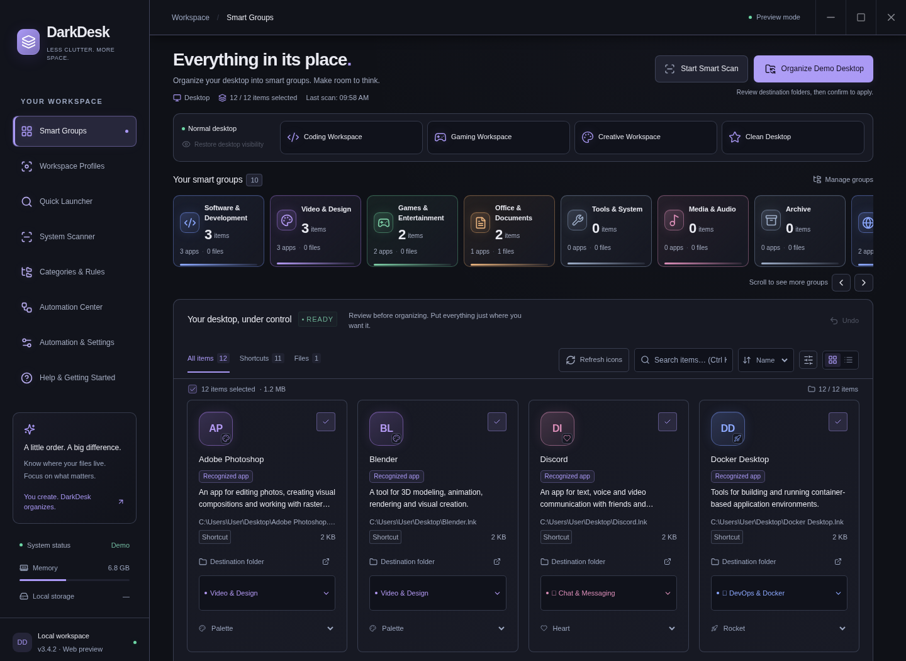
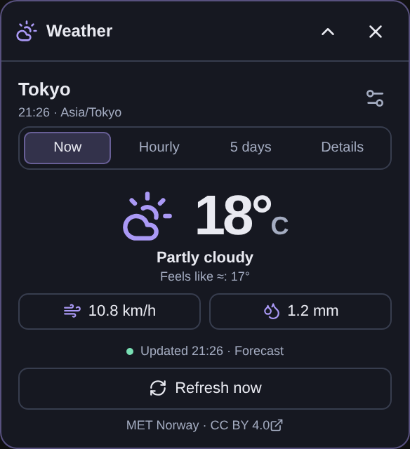
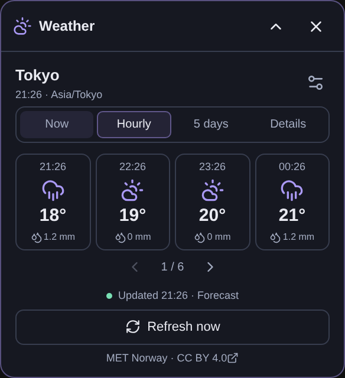

  
  
<strong>A place for every file. More room to focus.</strong>

  
Organize your desktop, find your apps and keep useful tools within reach. Review changes before applying them. Undo when you need to.

  

    <a href="https://github.com/Huseyinhk61/DarkDesk/releases/latest"><strong>Download DarkDesk</strong></a> ·
    <a href="docs/QUICK_START.md">Getting started</a> ·
    <a href="docs/KULLANIM.md">Türkçe rehber</a> ·
    <a href="https://github.com/Huseyinhk61/DarkDesk/issues/new?template=bug_report.yml">Get help</a>
  

  
  
  
    
  
  
Interface screenshots use demonstration data.

## Download and install

Open **[the latest stable release](https://github.com/Huseyinhk61/DarkDesk/releases/latest)** and choose the file for your computer:

| Your computer                   | File to choose                           | How to start                                      |
| ------------------------------- | ---------------------------------------- | ------------------------------------------------- |
| **Windows — recommended**       | **DarkDesk-Setup-&lt;version&gt;.exe**   | Open it and follow the installation wizard.       |
| Windows — portable              | DarkDesk-Portable-&lt;version&gt;.exe    | Open it without installing.                       |
| Ubuntu / Debian                 | DarkDesk-&lt;version&gt;-amd64.deb       | Open it with your software installer.             |
| Other compatible Linux desktops | DarkDesk-&lt;version&gt;-x86_64.AppImage | Allow the file to run as a program, then open it. |

**You do not need Node.js, npm or a terminal to use the Windows installer.** GitHub's **Source code (zip)** is for developers; choose the Setup EXE for normal Windows use. Downloads include checksums for verification. Windows packages are currently unsigned and may show a publisher warning.

DarkDesk supports 64-bit Windows 10 (19041+) / Windows 11 and compatible Linux desktops. For Linux prerequisites and AppImage/FUSE help, see the [Linux guide](docs/LINUX.md). Microsoft Store publication is still pending; use the stable downloads above.

## Get organized in a minute

1. **Scan your desktop.** Use System Scanner to switch between Desktop, installed apps, Downloads or a folder you choose.
2. **Review your groups.** Change a category from the item card, or drag the item onto a group.
3. **Preview and organize.** Check the destinations, then confirm. Installed applications receive shortcuts; their program folders stay in place.
4. **Undo if needed.** Use Undo in the result notification or operation history.

Want a walkthrough? Read the [quick-start guide](docs/QUICK_START.md) or [Türkçe kullanım rehberi](docs/KULLANIM.md).

## Make your desktop work for you

- **Smart groups:** organize apps and files, create subgroups and add your own keyword or regex rules. Matching suggestions explain their reasoning and remain editable.
- **Your folders, your style:** choose colors, gradients, seven folder styles and 34 icons. On Windows, category folder artwork can match your choices. Open **Categories & Rules → Customize**.
- **Workspace profiles:** show the items you need for coding, gaming or creative work. Default Mode restores the items DarkDesk hid.
- **Quick Launcher:** press **Alt+X** to find apps, use favorites, calculate, search the web or convert currency. Try `1 usd tl`, `50 eur`, `calc 120 * 45` or `g desktop shortcuts`.
- **Daily widgets:** keep weather, notes, tasks, a clock, a focus timer and system readings close at hand. Choose size and opacity; content uses fixed views and pages.
- **A comfortable interface:** dark and light themes, font choices, text size, compact spacing and reduced motion. Turkish/English are the primary languages; German/French/Spanish core translations are beta.

## A clearer weather widget

Choose your city in **Desktop Widgets → Weather**, then open the panel. No account or API key is required.

- **Now:** temperature, estimated feels-like value, wind and precipitation.
- **Hourly:** page through the next 24 hours without scrolling.
- **5 days:** compare forecast temperature ranges and conditions.
- **Details:** humidity, pressure, gusts, wind direction, cloud cover and available rain probability.

Forecast times and day boundaries follow the selected city's time zone. Use Weather settings for custom coordinates, time zone and Celsius/Fahrenheit. Update time, cached readings and connection problems are visible. Missing provider fields appear as unavailable values.

<table>
  <tr>
    <td align="center"><strong>Now</strong> </td>
    <td align="center"><strong>Hourly</strong> </td>
  </tr>
</table>

Weather is provided by MET Norway under CC BY 4.0. These are forecasts, not live station observations. Feels-like values are estimates, and daily ranges come from available forecast samples. [Weather guide](docs/WEATHER.md).

## Useful shortcuts

| Shortcut / input      | What it does                                       |
| --------------------- | -------------------------------------------------- |
| **Alt+X**             | Open Quick Launcher.                               |
| **Ctrl+Alt+0**        | Return to Default Mode.                            |
| Ctrl+Alt+1…4          | Switch between the built-in workspace profiles.    |
| `?` in Quick Launcher | Show examples and available prefixes.              |
| `1 usd tl`            | Convert USD to Turkish lira using reference rates. |

Change these assignments in **Workspace Profiles → Global shortcuts**. Availability depends on your operating system and other apps using the same keys. Currency conversions use dated reference rates; the selected default currency applies when you omit a target.

## Updates, privacy and help

**Update:** Windows Setup and Linux AppImage editions notify you about available updates. Open **Settings → Updates** to check, download and restart. Portable and DEB editions use manual downloads. Quit DarkDesk from the tray menu before replacing an installation. [Update help](docs/UPDATES.md).

**Your data:** files, notes, tasks and operation history stay on your device. Optional analytics and automation start disabled. Weather sends manually selected coordinates to MET Norway; currency conversion requests reference rates. Optional online app-description matching and web searches contact their respective providers. [Privacy notice](docs/PRIVACY.md).

**Need help?** Open **Help & Getting Started → Help & support** to copy version/platform information, then [report a problem](https://github.com/Huseyinhk61/DarkDesk/issues/new?template=bug_report.yml). Include what you did, what happened and any visible error message. Keep personal files and credentials out of reports.

<strong>Developers and Store publishers</strong>

Source setup, architecture and checks: [Development guide](docs/DEVELOPMENT.md). Microsoft Store identity, unsigned submission packages and certification: [Store publishing guide](docs/MICROSOFT_STORE.md). These developer files are separate from the end-user installers above.

[Test results](docs/VALIDATION.md) · [Release history](CHANGELOG.md) · [Contributing](CONTRIBUTING.md) · [Security](SECURITY.md)

