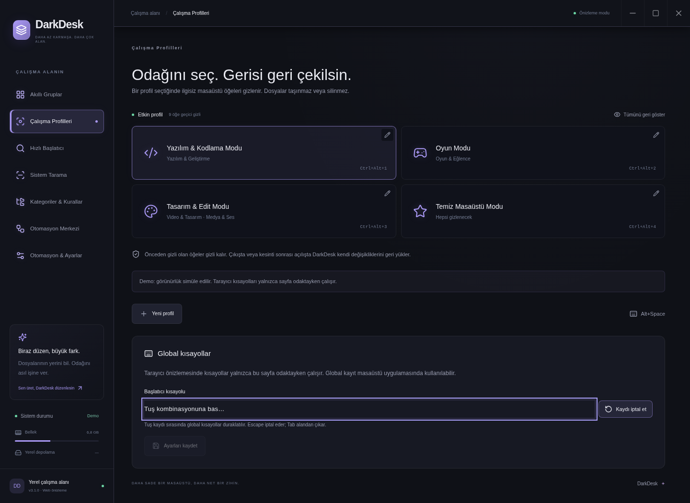

# Native icons, app details, and shortcuts

## Application icons and information

DarkDesk uses Electron `app.getFileIcon` to show operating-system icons in cards and Spotlight results. For `.lnk` files, it first tries the shortcut's icon, then its local target. If the operating system cannot provide an icon, DarkDesk uses the selected category or item icon. Icon packs customize category and fallback icons.

Click a card's icon or name to open its information panel. You can also use Tab and Enter. File sizes and dates come from the file system; for shortcuts, they describe the shortcut file. On Windows, executable descriptions and company names come from version resources; shortcuts use their local executable target. These optional fields are not verified publisher identities. Missing information is labeled explicitly.

Last launch records only launch requests successfully submitted through DarkDesk. It does not track applications opened elsewhere or their running time. The browser demo does not invent native icons or publisher metadata.

**Estimated usage** remains available on cards and in the details panel even when optional native metadata is unavailable. It uses valid DarkDesk launch history first; otherwise it supplies a category estimate such as Intensive use or Continuous use. The source note distinguishes observed launch counts from estimates. Neither indicates that an app is running now or measures activity elsewhere in Windows.

Category icon backgrounds follow saved custom HEX or gradient colors; original application logos remain intact. See [folder appearance](FOLDER-APPEARANCE.md) for matching physical Windows icons.

The renderer cannot submit arbitrary file paths to read metadata: IPC accepts only IDs from the trusted scan index. Icons load for visible cards, with bounded concurrency and caches. Windows metadata extraction uses JSON over stdin, a timeout, and an output limit rather than interpolating file names into commands.

## Global shortcuts

Open **Workspace Profiles → Global shortcuts** to change the launcher or profile bindings. The launcher recorder is also available in Settings.

1. Click **Record keys** or the shortcut field.
2. Press a letter, number, Space, or function key with a modifier such as Ctrl, Alt, or Command.
3. Save the combination. Escape cancels recording; Tab, loss of focus, and a timeout also leave recording mode.

DarkDesk temporarily suspends its global shortcuts while recording, so pressing a profile combination does not activate that profile. Registration resumes afterward. Duplicate profile bindings are rejected. If another application or the operating system owns the new combination, DarkDesk rejects it and preserves the previous working binding. Unrelated settings changes, such as changing a theme, do not unregister working shortcuts.

New installations use **Alt+X** for the launcher; existing personal bindings are preserved. A successfully registered shortcut works while DarkDesk is unfocused or in the system tray. Operating-system restrictions, reserved combinations, some full-screen games, and secure desktop screens can still prevent activation. The status panel reports the actual registration result. If a combination conflicts, try another, such as `Ctrl+Shift+Space`. Browser-demo shortcuts work only while the page has focus.

## Quick item actions

Within Quick Launcher, select an application or file and press **Tab** or **Ctrl+K** to open its action menu. Add or remove a favorite, reveal the file location, or request **Run as Administrator** for supported Windows executable/shortcut results. The administrator action uses Windows UAC; it does not bypass approval. Escape closes the menu and restores search focus. Unsupported actions are disabled.

Result badges identify applications, files, commands, calculations, conversions, and web searches. Empty search puts the three most-used observed items before other favorites. Full calculator, web-prefix, system-command, and keyboard instructions are in the [launcher guide](LAUNCHER.md).

## Fixed desktop layout

The sidebar and draggable title bar stay in place while the main content scrolls. Window controls have click targets of at least 44 × 44 pixels. On narrow or short screens, navigation can scroll independently to remain accessible. Information panels and other dialogs open above the window content, close with Escape, and return focus to the button that opened them.
