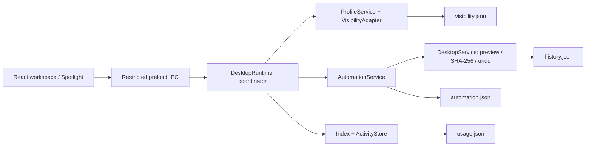

# Profiles, launcher, and background automation

## Workspace profiles

Choose Coding, Gaming, Design, or Clean Desktop in **Workspace Profiles**. Categories included in a profile, together with their subgroups, stay visible. Other ordinary desktop files and folders are temporarily hidden. The profile editor lets you change categories, the shortcut, and names of existing files or folders that should always remain visible.

Default profile bindings:

| Profile       | Shortcut   |
| :------------ | :--------- |
| Coding        | Ctrl+Alt+1 |
| Gaming        | Ctrl+Alt+2 |
| Design        | Ctrl+Alt+3 |
| Clean Desktop | Ctrl+Alt+4 |

On Windows, DarkDesk changes only the **Hidden** bit through .NET `File.GetAttributes` / `File.SetAttributes`, preserving other attributes. A single batched PowerShell call applies the changes and notifies Explorer. Previously hidden items stay hidden. The user's **Show hidden items** preference can affect the visual result; profiles do not provide access isolation.

On Linux, names are merged into `.hidden`, preserving existing entries. The visible result depends on the desktop manager's support for that file. Profile visibility is not currently supported on macOS.

Before the first attribute change, DarkDesk writes and syncs a `visibility.json` journal. **Show all** and a normal **Quit** restore original visibility. After a forced termination, the next launch attempts recovery from the journal. A replacement file with the same name does not inherit an old file's attributes. Power loss, permission changes, or external modifications can prevent complete recovery; DarkDesk retains the journal and reports the error.

## Spotlight launcher

New installations use the global shortcut **Alt+X**. Change it in **Settings → Launcher shortcut**, for example to `Ctrl+Space`. Existing personal bindings are preserved. If another application or the operating system owns the combination, **Workspace Profiles → Global shortcuts** shows the registration result. Browser-demo shortcuts work only while the page has focus.

- Fuzzy search covers indexed desktop files, discovered apps, and imported Downloads items.
- Use `↑` / `↓` to select, `Enter` to open, and `Esc` to close.
- **Organize Desktop** opens a confirmation preview; it does not silently move files.
- Profile commands change visibility; **Open DarkDesk** shows the main window.
- Native launch opens only indexed items that are still ordinary files, using the operating system's registered opener. The renderer cannot execute an arbitrary path or shell command.
- Calculations and unit conversions produce local result cards; Enter copies a canonical result while display formatting follows the interface language.
- `g`, `yt`, and `gh` results open fixed Google, YouTube, or GitHub search URLs only after activation.
- Tab or Ctrl+K opens item actions: persistent favorites, file location, and supported Windows administrator launch through UAC.
- An empty query shows up to three items with the highest observed DarkDesk launch counts, then other favorites, without duplicating an item.
- Windows Lock Screen and Toggle Mute run after selection. Empty Recycle Bin and Shut Down require a separate, single-use confirmation that expires after 30 seconds.

See [Quick Launcher](LAUNCHER.md) for examples and platform availability. Native system actions are fixed operations rather than arbitrary renderer-supplied commands. Tests inject adapters for disruptive OS actions; they do not shut down, lock, mute, or clear the development host's bin.

## Usage history and inactive items

`usage.json` records only **launch requests successfully submitted through DarkDesk**. It does not observe Windows-wide activity or launches from other applications. Files without history on a fresh installation are not labeled unused for six months.

DarkDesk suggests Archive when the last observed DarkDesk launch is more than six months old. Accepting the suggestion changes the category assignment; moving the file still requires separate confirmation. The counter does not measure running time. Favorites are stored with this local history without increasing the launch count.

Cards and details derive a nonempty **Estimated usage** label from valid DarkDesk history, or from the app/category when history is unavailable. Category-derived labels are explicitly estimates, not observations of Windows processes. A recent-launch label and the six-month Archive suggestion serve different purposes; a category estimate never establishes inactivity.

## Archive and Downloads automation

Both automations are **off by default**. Configure them in **Automation Center**, choose **Preview rules**, then enable them and choose **Save rules**.

- **Archive:** Evaluates ordinary desktop files by last modification time. By default, it moves files older than 30 days to the selected Archive category. It does not move folder contents or installed application directories.
- **Downloads:** Skips incomplete `.crdownload`, `.part`, `.download`, `.tmp`, and excluded files. After size/date checks and a default 10-second stability delay, it routes files to desktop categories using types and rules. The default method is **copy**; users can choose move.
- The background timer checks roughly every five seconds, including while DarkDesk is in the tray. A stable size and timestamp do not prove a download has finished; increase the delay or use copy for slow downloads.
- Operations use the main file service's content verification, destination collision checks, and persistent undo journal.
- An explicit **Undo** protects that restored file version from immediate reprocessing. A later modification can make it eligible again. Matching uses item identity, size/date version information, and operation history.
- If a profile is active, DarkDesk restores original attributes before a physical operation and reapplies the profile afterward. A visibility-related `ctime` change is reconciled with the preview by verifying that the content hash is unchanged.

## Rules, exclusions, and subgroups

Personal rules can use **contains**, **extension**, or **Regex (RE2)** matching. The first matching rule wins; manual assignments take priority. For example, `setup|installer|driver|update` can route to System → Installers. Regex is evaluated separately against the file name and target, without case sensitivity. The RE2JS engine does not support lookaround or backreferences. Invalid patterns cannot be saved.

The default catalog contains 10 main groups and 25 groups in total, including IDEs & Editors, Databases, DevOps & Docker, Terminal, Drivers, Network & Security, Compression, System Utilities, Installers, and browser, communication, learning, and finance subgroups. Settings migrations preserve existing custom categories and assignments.

Automation Center filters control excluded directory names, helper-app words, allowed names, and scan depth. System32, AppData, Temp, node_modules, and cache directories are excluded from ordinary discovery; the **Start Menu** is an explicit exception root. Allowed file names take priority over helper-app filtering. `.dll`, `.sys`, and `.ini` files are not application index entries. The default depth is 8; the maximum is 12.

## Local tag suggestions

Unknown file names are compared with vectors built from category titles and local keyword seeds, using weighted cosine similarity similar to TF/IDF. File contents are not read, no network request is made, and no LLM or model download is required.

DarkDesk makes no suggestion when the match is too weak. The displayed similarity is not a calibrated probability of correctness. **Apply suggestion** saves a category assignment only with the user's confirmation.

## Drag and drop

Dropping a card on a main category changes its assignment immediately. It does not physically move the file. A dropdown provides the same action for keyboard users.

Dropping ordinary files from Desktop or Downloads onto a category opens a controlled operation preview. Arbitrary paths outside those roots are not accepted. Electron `webUtils.getPathForFile` obtains the native path without giving the page general file-system access. The browser demo creates sample records only.

## Tray and exit

`X` hides the main window to the tray. The tray menu includes **Open DarkDesk**, **Organize Desktop Now**, **Switch Profile**, **Quick Search**, and **Quit**. If a tray cannot be created, DarkDesk quits normally rather than leaving its window inaccessible.

Quitting waits for the current file operation, flushes usage records, restores profile visibility, and unregisters global shortcuts. Tray and visibility support on Linux depends on the desktop manager.

## Modules

Mutating operations run serially through one coordinator. Global shortcuts, the tray, the timer, and the renderer use the same entry point. Automation never launches applications; the user selects them in the launcher.
