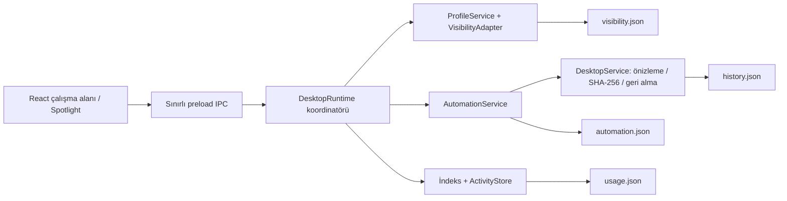

# DarkDesk 3.0: profiller, başlatıcı ve arka plan kuralları

## Çalışma profilleri

**Çalışma Profilleri** bölümünden Kodlama, Oyun, Tasarım veya Temiz Masaüstü profilini seç. Profildeki kategoriler ve alt grupları görünür kalır; diğer normal masaüstü dosya/klasörlerine geçici gizlilik uygulanır. Profil düzenleyicisinde kategori listesini, kısayolunu ve ayrıca görünür tutulacak mevcut dosya/klasör adlarını değiştirebilirsin.

Varsayılanlar:

| Profil            | Kısayol    |
| :---------------- | :--------- |
| Yazılım & Kodlama | Ctrl+Alt+1 |
| Oyun              | Ctrl+Alt+2 |
| Tasarım & Edit    | Ctrl+Alt+3 |
| Temiz Masaüstü    | Ctrl+Alt+4 |

Windows’ta .NET `File.GetAttributes` / `File.SetAttributes` ile yalnızca **Hidden** biti değiştirilir; diğer nitelikler korunur. İşlemler tek bir toplu PowerShell çağrısıyla uygulanır. Explorer’a nitelik değişikliği bildirimi gönderilir. Önceden gizli öğeler açılmaz. Kullanıcının **gizli öğeleri göster** tercihi görünümü etkileyebilir; bu bir güvenlik/erişim izolasyonu değildir.

Linux’ta `.hidden` dosyasındaki isimler birleştirilir; mevcut liste korunur. Görsel sonuç masaüstü yöneticisinin `.hidden` desteğine bağlıdır. macOS profil görünürlüğü şu anda desteklenmez.

İlk nitelik değişiminden önce `visibility.json` günlüğü yazılır ve diske senkronize edilir. **Tümünü geri göster** veya normal **Çıkış**, özgün görünürlüğü geri yükler. Zorla sonlandırma sonrası yeniden açılışta bu günlükten kurtarma yapılır. Aynı isimle değiştirilmiş farklı bir dosyanın niteliği eski kayıtla değiştirilmez. Elektrik kesintisi, izin kaybı veya dosyaların dışarıdan değiştirilmesi durumunda eksiksiz kurtarma garantisi yoktur; günlük korunur ve hata gösterilir.

## Spotlight / hızlı başlatıcı

Varsayılan global kısayol **Alt+Space**. **Otomasyon & Ayarlar → Başlatıcı kısayolu** ile örneğin `Ctrl+Space` seçebilirsin. OS veya başka bir uygulama kısayolu almışsa kayıt sonucu **Çalışma Profilleri → Global kısayollar** bölümünde görünür. Web demosunda `Ctrl+Space`/`Alt+Space` yalnızca sayfa odaktayken çalışır.

- İndekslenen masaüstü dosyaları, keşfedilen uygulamalar ve içe alınmış Downloads öğelerinde fuzzy arama.
- `↑` / `↓` ile seçim; `Enter` ile açma; `Esc` ile kapatma.
- **Masaüstünü Düzenle** komutu onay önizlemesi açar; dosyaları sessizce taşımaz.
- Profil komutları görünürlüğü değiştirir; **DarkDesk Aç** ana pencereyi gösterir.
- Native başlatma, yalnızca ana sürecin indeksindeki ve hâlâ normal dosya olan öğeleri OS’nin kayıtlı açma yöntemiyle açar. Renderer’dan keyfi bir dosya yolu veya shell komutu çalıştırılamaz.

## Kullanım sıklığı ve atıl öğeler

`usage.json` yalnızca **DarkDesk başlatıcısı üzerinden başarılı gönderilen açma isteklerini** kaydeder. Windows genelindeki veya başka bir uygulamadaki kullanımı izlemez. İlk kurulumda geçmişi olmayan dosya “altı aydır kullanılmadı” diye işaretlenmez.

Son gözlenen DarkDesk başlatması altı aydan eski olan öğelerde Arşiv kategorisi önerisi gösterilir. Öneriyi kabul etmek kategori tercihini değiştirir; fiziksel taşıma ayrıca onaylanır. Sayaç, bir uygulamanın ne kadar süre kullanıldığını ölçmez.

## Arşiv ve Downloads otomasyonu

Her iki otomasyon **başlangıçta kapalıdır**. **Otomasyon Merkezi** içinden ayarla, **Kuralları önizle**, ardından etkinleştirip **Kuralları kaydet** ile uygula.

- **Arşiv:** Masaüstündeki normal dosyaları son değiştirilme zamanına göre değerlendirir. Varsayılan 30 günden eski dosyaları seçili Arşiv kategorisine taşır. Klasörlerin içi ve kurulu uygulama dizinleri taşınmaz.
- **Downloads:** Tamamlanmamış `.crdownload`, `.part`, `.download`, `.tmp` ve dışlanmış dosyaları atlar. Boyut/tarih kontrolü ve varsayılan 10 saniyelik kararlılık gecikmesi sonrasında dosyayı türüne/kurallara göre masaüstüne yönlendirir. Başlangıç yöntemi **kopyalama**dır; kullanıcı taşıma seçebilir.
- Arka plan zamanlayıcısı yaklaşık beş saniyede bir kontrol eder; uygulama tepsideyken de çalışır. Kararlılık gecikmesi indirme uygulamasının işi bitirdiğinin kesin kanıtı değildir; özel yavaş indirmelerde süreyi artır veya kopyalamayı kullan.
- İşlemler ana dosya servisinin içerik doğrulamasını, hedef çakışması korumasını ve kalıcı geri alma günlüğünü kullanır.
- Açık bir **Geri al** isteği, geri yüklenen dosya sürümünü tekrar işlenmekten korur. Dosya değiştiğinde kurala yeniden aday olabilir. Eşleştirme öğe kimliği, boyut/tarih sürüm bilgisi ve işlem günlüğüne dayanır.
- Aktif profil varken fiziksel işlem öncesi özgün nitelikler geri alınır, işlemden sonra profil yeniden uygulanır. Görünürlük kaynaklı `ctime` değişimi, içeriğin değişmediği hash ile doğrulanarak önizlemeye yeniden bağlanır.

## Regex, istisnalar ve alt gruplar

Kişisel kurallar **içeriyor**, **uzantı** veya **Regex (RE2)** olabilir. İlk eşleşen kural kazanır; manuel atama önceliklidir. Örneğin `setup|installer|driver|update`, Sistem → Kurulumlar grubuna yönlendirilebilir. Regex dosya adı ve hedef üzerinde ayrı değerlendirilir; büyük/küçük harf duyarsızdır. RE2JS motoru kullanılır; lookaround ve geri başvurular desteklenmez. Geçersiz desen kaydedilmez.

Varsayılan alt gruplar: IDE & Editörler, Veritabanı, DevOps & Docker, Terminal, Sürücüler, Ağ & Security, Sıkıştırma, Sistem Araçları ve Kurulumlar. Önceki özel kategoriler korunarak yeni varsayılanlar göç edilir.

Otomasyon Merkezi’ndeki filtrelerle dışlanan dizin adlarını, yardımcı uygulama kelimelerini, izin verilen adları ve derinliği ayarla. System32, AppData, Temp, node_modules ve cache dizinleri standart keşiften dışlanır; **Başlat Menüsü** açık bir istisna köküdür. İzin verilen dosya adları yardımcı uygulama filtresinden önceliklidir. `.dll`, `.sys`, `.ini` uygulama indeksi değildir. Varsayılan derinlik 8, izin verilen azami derinlik 12’dir.

## Yerel akıllı etiketleme

Bilinmeyen dosya adları, kategori başlıkları ve yerel anahtar kelime tohumlarından oluşturulan vektörlerle karşılaştırılır. TF/IDF benzeri ağırlıklı kosinüs benzerliği kullanılır. Dosya içeriği okunmaz, ağ isteği yapılmaz ve LLM/model indirmesi gerekmez.

Yeterli eşleşme yoksa öneri yapılmaz. Gösterilen benzerlik değeri kalibre edilmiş doğruluk olasılığı değildir. **Öneriyi uygula** yalnızca kullanıcı onayıyla kategori tercihini kaydeder.

## Sürükle-bırak

Bir kartı ana kategori kartına bırakmak, kategori atamasını hemen değiştirir. Bu hareket tek başına fiziksel dosya taşımaz; klavye için açılır menü alternatifi vardır.

OS’den masaüstü veya Downloads içindeki normal dosyaları kategoriye bırakmak, kontrollü bir işlem önizlemesi açar. Desktop/Downloads dışından keyfi yollar kabul edilmez. Native dosya yolu Electron `webUtils.getPathForFile` ile alınır; sayfaya genel dosya sistemi erişimi verilmez. Web demosu yalnızca örnek kayıtlar oluşturur.

## Tepsi ve çıkış

`X` ana pencereyi tepsiye gizler. Tepsi menüsünde **DarkDesk Aç**, **Masaüstünü Şimdi Düzenle**, **Profil Değiştir**, **Hızlı Arama** ve **Çıkış** vardır. Sistem tepsisi oluşturulamıyorsa pencereyi erişilemez bırakmak yerine normal çıkış yapılır.

Çıkış, sürmekte olan dosya işlemini bekler, kullanım kayıtlarını tamamlar, profil görünürlüğünü geri yükler ve global kısayolları kaldırır. Tepsi/görünürlük desteği Linux masaüstü yöneticisine bağlıdır.

## Modüller

Değiştirici işler tek koordinatörde seri çalışır; global kısayol, tepsi, zamanlayıcı ve renderer aynı kapıyı kullanır. Açma işlemleri otomasyon tarafından tetiklenmez; kullanıcı başlatıcıdan seçer.
