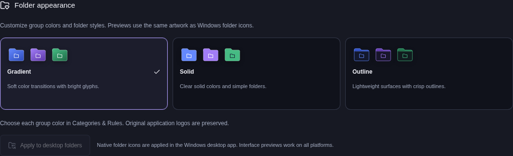
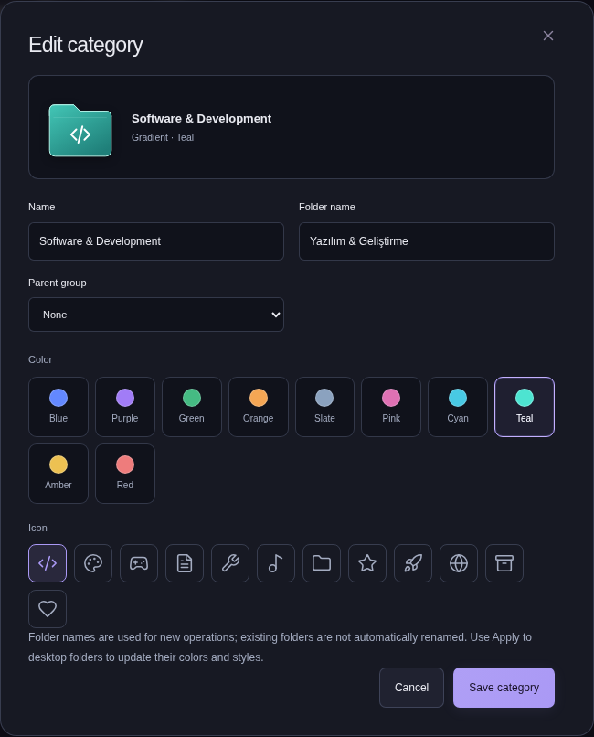

# Folder colors and styles

DarkDesk 3.5 adds a separate appearance system for category folders. Changing the application palette, interface icon pack, or font does not require changing folder colors. Original application logos and existing file icons are preserved.

## Choose a folder appearance

1. Open **Categories & Rules**, then edit a category or create a subgroup.
2. Choose its glyph and one of ten colors: Blue, Purple, Green, Orange, Slate, Pink, Cyan, Teal, Amber, or Red. The live preview updates before saving.
3. In **Folder appearance**, choose **Gradient**, **Solid**, or **Outline**. The style applies across groups while each group retains its own color and glyph.
4. Save the category. New Windows category folders receive the chosen appearance when you organize files into them.

The same artwork powers interface previews and 360 bundled Windows folder icons: three styles × ten colors × twelve glyphs. Native folder artwork is distinct from the five interface icon packs.

## Apply to existing Windows folders

Open **Folder appearance** in **Categories & Rules** or **Automation & Settings**, then choose **Apply to desktop folders**. This explicit action updates existing category folders; it does not organize, move, copy, delete, or launch their contents. It does not create missing category folders just to show an icon.

DarkDesk writes its `.darkdesk.ico` and `desktop.ini` metadata and the Explorer attributes needed to display the icon. It recognizes its own earlier metadata from operation history or its local appearance record. Manually customized or unrecognized icon metadata is skipped rather than overwritten. Symlinked or unverifiable paths are also skipped. No automatic elevation is requested.

The result shows how many folders were **updated**, **unchanged**, **skipped**, or **failed**. Expand the details to see why a folder was skipped or could not be updated:

| Result                                       | What to do                                                                                            |
| :------------------------------------------- | :---------------------------------------------------------------------------------------------------- |
| Category folder not created                  | Organize an item into that category when ready. Its chosen appearance will be used then.              |
| Custom icon files preserved                  | Keep the existing custom icon, or manage that customization yourself in File Explorer.                |
| Windows denied access                        | Check your access to that folder and retry when it is writable.                                       |
| Icon file changed or path cannot be verified | Check the folder in File Explorer before retrying.                                                    |
| Appearance information could not be read     | Keep the local appearance record and operation history; inspect the error before making more changes. |

Explorer may cache an older icon. DarkDesk asks Explorer to refresh; if that refresh cannot complete, the result suggests opening the folder and pressing **F5**. A successful metadata update does not establish how quickly Explorer will redraw every desktop icon.

## File undo and appearance changes

Folder appearance is a visual preference, separate from file-operation undo. If you organize files, apply a newer folder style, and then undo the file organization, the files return while the newer style is preserved. An empty styled folder can remain after that undo because its newer appearance metadata is retained. Inspect and remove an empty folder yourself if you no longer need it.

Changing a category's label, folder name, or parent does not rename existing physical folders. **Apply to desktop folders** targets the category's current configured path. Review folder paths when editing an established hierarchy.

## Platform support

Native folder appearance is supported in the **Windows Electron desktop app**. Browser previews and other platforms display the same interface previews, but their apply control is unavailable. Browser mode does not access your desktop. Existing application shortcuts continue to use their original logos unless you explicitly assign a custom shortcut icon.
