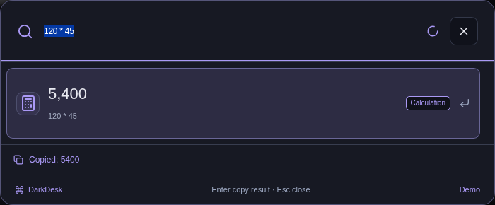
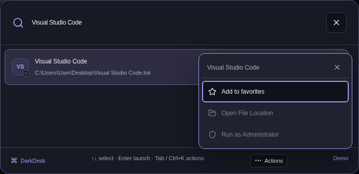

# Quick Launcher

Press **Alt+X** on a new installation, or use your saved launcher shortcut. DarkDesk searches indexed applications, files, and commands. An empty query places the three items with the highest observed DarkDesk launch counts first, followed by other favorites. This history is local; it does not measure launches made elsewhere or running time.

Use **↑ / ↓** to select a result, **Enter** to activate it, and **Esc** to close. Result badges distinguish apps, files, commands, calculations, conversions, and web searches. Type a query to return to fuzzy search across the indexed collection.

## Prefix guide and frequent commands

A compact guide appears below the normal empty-query results. Type `?`, enter only spaces, or press **F1** to open its expanded form. Selecting an example fills the query; it does not run the operation. Use the arrow keys to choose a result and Enter to activate it.

| Prefix | Purpose                  | Example                  |
| :----- | :----------------------- | :----------------------- |
| `g`    | Google search            | `g desktop widgets`      |
| `yt`   | YouTube search           | `yt OBS Studio tutorial` |
| `gh`   | GitHub search            | `gh electron`            |
| `calc` | Local calculator         | `calc 120 * 45`          |
| `sys`  | Supported system actions | `sys lock`               |

Successfully activated local commands can appear as frequent suggestions on empty search. The local record contains a fixed command ID, count, and last-use timestamp. It does not save calculator input or web-search queries. Canceling a destructive confirmation does not record a successful command.

## Calculate and convert

Type an expression or conversion directly into the search field:

| Input           | Result copied with Enter |
| :-------------- | :----------------------- |
| `120 * 45`      | `5400`                   |
| `calc 120 * 45` | `5400`                   |
| `(2 + 3) * 4`   | `20`                     |
| `1,5 * 4`       | `6`                      |
| `10 km to m`    | `10000 m`                |
| `32 F to C`     | `0 °C`                   |
| `1 GB to MB`    | `1000 MB`                |
| `1 GiB to MiB`  | `1024 MiB`               |

The display follows the selected language's number formatting. Copied numbers omit thousands separators so they paste cleanly into another app. A conversion includes its target unit. After copying, the launcher remains open and selects the input for the next calculation.

The optional `calc` prefix explicitly selects arithmetic; bare expressions and bare unit conversions continue to work. The calculator supports parentheses, unary signs, addition, subtraction, multiplication, division, powers (`^` or `**`), and binary remainder (`%`). Unit conversion covers length, mass, time, temperature, and data. Use explicit units; incompatible dimensions and non-finite results display an error and cannot be copied. These operations run locally without evaluating arbitrary code or contacting a service.

## Search the web

| Prefix | Destination | Example                       |
| :----- | :---------- | :---------------------------- |
| `g`    | Google      | `g desktop organization`      |
| `yt`   | YouTube     | `yt DaVinci Resolve tutorial` |
| `gh`   | GitHub      | `gh react hooks`              |

Typing creates a result only. Press **Enter** or select the result to open the encoded search. The desktop app uses the default browser; browser preview opens a new tab. Native requests accept these fixed HTTPS search providers rather than an arbitrary URL or shell command. The query is sent to the chosen provider when the result is activated.

## Item actions and favorites

Select an application or file result, then press **Tab** or **Ctrl+K**, or choose **Actions**. Use arrow keys to move through its action menu; **Esc** returns to search without closing the launcher.

- **Add to favorites / Remove from favorites** saves a local preference. A star marks saved favorites. Favoriting an item does not increase its usage count.
- **Open File Location** reveals an indexed local file in the desktop file manager.
- **Run as Administrator** is available for supported Windows executable and shortcut results. DarkDesk checks the trusted file and target, then uses the Windows UAC prompt. It does not bypass elevation consent.

Actions unavailable on the current platform are disabled. Results are checked against the trusted index and their current files.

### Organized files and restarts

DarkDesk 3.6.1 recovers launcher entries for files it organized by checking completed, verified operation history and recorded category destinations beneath the Desktop. A moved item keeps its original identity, so its favorite and observed launch counts follow it into the category folder. Undo returns the launcher entry to the restored source; recovery also works after restarting the app.

When an original copy or indexed installed executable is still available, it takes priority over a generated copy or shortcut. Missing and stale entries are removed. Unchanged managed outputs reuse a bounded verification cache; changing a file invalidates that verification.

This recovery does not recursively index arbitrary folders. It rejects symlinked paths and managed outputs whose contents no longer match the recorded operation. User-modified or missing outputs may therefore be absent from the recovered results. To index an edited file, use a supported scan source such as Desktop or Downloads and scan it explicitly. File-operation Undo retains its existing content checks and does not become less restrictive.

Closing and reopening the launcher starts a new session. A delayed response from the previous session cannot replace its results, show an older confirmation, or close the new palette.

## Windows system commands

Type `sys` to list supported actions, or enter an exact alias such as `sys lock`, `sys mute`, `sys empty trash`, or `sys shutdown`. English and Turkish aliases are supported. A partial phrase selects an example to complete the input; it does not dispatch a system action. Exact prefixed commands use the same platform checks and confirmations as ordinary command results.

| Command               | Behavior                                                                                                                                                                                          |
| :-------------------- | :------------------------------------------------------------------------------------------------------------------------------------------------------------------------------------------------ |
| **Lock Screen**       | Requests the Windows lock screen after activation.                                                                                                                                                |
| **Toggle Mute**       | Sends the system mute key; it toggles sound rather than claiming a known current mute state.                                                                                                      |
| **Empty Recycle Bin** | Requests a separate confirmation before permanently clearing the bin. This is outside DarkDesk's file-operation undo.                                                                             |
| **Shut Down**         | Requests confirmation before shutting down. Save open files first; DarkDesk flushes widget drafts and analytics, restores profile visibility, and saves window state before the shutdown request. |

Recycle-bin and shutdown confirmations expire after 30 seconds and can be used once. Before dispatch, Cancel or **Esc** returns to search. After confirming, the command has been sent and Escape does not cancel it. If a confirmation expires, cancel and select the command again. Query text alone never runs a system command.

## Platform support

The Windows Electron application provides the system commands and administrator action. Native file reveal depends on the desktop file manager. Browser preview supports calculator/converter results, clipboard copying where the browser permits it, and explicit web searches; it does not reveal real local files, elevate apps, or execute system commands.

Automated tests use injected adapters for shutdown, lock, mute, and recycle-bin operations. They do not execute those commands on the development host. See the [validation report](VALIDATION.md) for the completed platform checks.
