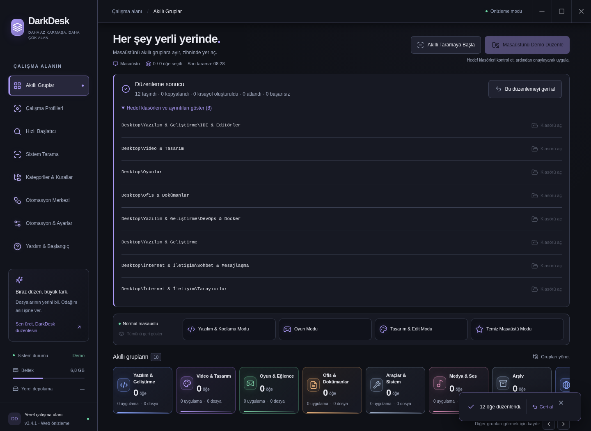

# Organizing files, displaying icons, and explaining apps

## Organizing files on disk

1. Scan your desktop, or discover installed applications in **System Scanner**.
2. Select cards and check each item's target category. The heading shows selected and total counts and the scanned source.
3. Choose **Organize Desktop** to preview destinations. Confirm the proposed moves, copies, or shortcut creation.
4. Review the actual action counts in the result panel. Open target folders or undo the latest operation from there.

Parent group totals include their subgroups once per item. Subgroup chips and breadcrumbs help narrow the list; each item shows the source of its category match. Use **Review** to inspect uncertain fallback assignments before organization.

Selecting a category or dragging a card to another group does not move its file. Installed executables stay in place; DarkDesk creates working shortcuts in category folders. Your own desktop files and shortcuts follow the move/copy preference in Settings.

Folder-icon decoration or timestamp-preservation failures do not block a successful file move; the result shows a warning. Critical copy, verification, journal, or deletion failures are reported explicitly. If the source cannot be removed, both the source and verified copy are retained. Existing destinations are never overwritten. Result details explain skipped items; check for an existing file with the same name.

## If an application logo is missing

**Refresh icons** clears cached temporary failures. On Windows, DarkDesk tries a shortcut's custom icon file and index, executable icon resources, and local `IconFile` entries in `.url` files. If native resource extraction fails, it tries the Electron shell icon. If no source is accessible, an initials fallback appears; DarkDesk does not present it as the original logo.

The browser demo cannot access operating-system icons. Initials in the README screenshots reflect this limitation. Newly created shortcuts to installed apps preserve their original icons unless the user explicitly selects a custom icon. Folder styles are a separate preference from application identity. Category folders have ten color options and three styles with matching native Windows icons. The [folder appearance guide](FOLDER-APPEARANCE.md) explains how to update existing folders without replacing manually customized icons.

## What does this app do?

Cards and the details panel show descriptions for applications recognized by the local catalog. For example, Visual Studio Code supports writing code, Chrome opens web pages, and Blender creates 3D content. Catalog matching uses names and targets; it does not verify executable identity.

Unrecognized items receive a clearly labeled estimate based on file type or category. DarkDesk does not read file contents or call an online AI service to create these descriptions. User assignments and custom rules take priority over automatic classification. Search matches purpose descriptions as well as application names.

## Desktop items left outside folders

The desktop scan now reads both the user's desktop and the Windows common desktop, discovered through the operating system's known-folder location. Common items have separate stable identities even when a personal shortcut has the same name. The scan coverage panel displays both source counts, unavailable sources, and intentionally excluded folders or file types. Existing directories are left in place.

- Select **Move files** to remove originals after verified copies. **Copy files** intentionally leaves originals visible; the preview explains this.
- A common-desktop move affects the shortcut visible to every Windows account. Review its source in the preview. If Windows denies access, the error is recorded, other selected items can continue, and a verified copied shortcut is retained until you review or undo it. DarkDesk does not silently elevate or convert the requested action.
- Conflicting destination names are skipped rather than overwritten. This also applies when personal and common shortcuts have the same name.
- Common-desktop items are excluded from unattended archive automation. Manual moves and copies have the same content checks and undo history as personal items.
- Steam, Epic, and other recognized game launch links in bounded UTF-8/UTF-16 `.url` files are categorized from their protocol without opening the link. Manual categories and custom rules take precedence.

The local purpose catalog includes FlutterFlow, VMware Workstation Pro and Windhawk, alongside DaVinci Resolve, AnyDesk, Epic Games Launcher and OBS Studio. Shortcut copy labels and product-version suffixes no longer prevent known-name matching. OBS Studio is grouped with video/design tools; saved manual assignments are preserved.
