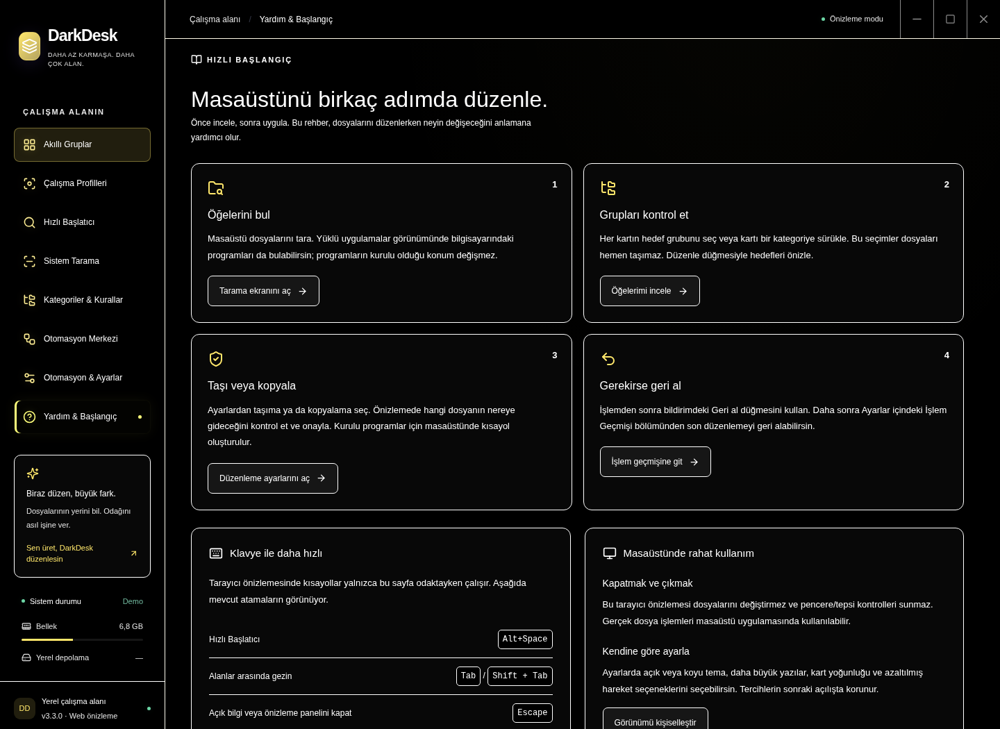

# Making DarkDesk comfortable to use

The in-app **Help** screen explains the organization workflow without an internet connection. It covers scanning, group selection, preview and confirmation, and undo. Its navigation buttons open the relevant view without starting file operations.

- Changing an item's target group does not move its file immediately. Physical organization requires an explicit confirmation after preview.
- Installed applications stay in their installation directories; DarkDesk creates desktop shortcuts for them.
- Choose move or copy in Settings. History shows the latest operation that can be undone.
- Help displays the user's current launcher and profile bindings, rather than fixed examples.
- Hiding to the tray and quitting are different actions. When a tray is available, X keeps DarkDesk running in the background. **Quit** in the tray menu closes the application and restores profile visibility.
- Scanning, grouping, and local tag suggestions do not upload files to a server. Launch history observes only launch requests submitted through DarkDesk.

Appearance settings include themes, text scaling, card density, and reduced motion. These controls support readability and keyboard use; they are not a claim of full compliance with a particular accessibility standard.

## Adjusting appearance

In **Settings → Appearance**, choose from **13 color palettes or System Theme**. System Theme follows the operating system's light/dark preference. Four local font-family choices and five icon packs provide further customization. Unavailable fonts use local fallbacks; no font download is required.

Set text size to 115% or 130% to make reading easier without enlarging window controls. Compact density fits more cards; Comfortable density adds space. Reduced motion can follow the operating system or be enabled manually.

Changing appearance preserves unsaved move/copy settings. Resetting appearance resets only visual preferences, keeping rules, categories, and operation history.

**Solarized Night** pairs deep teal surfaces with yellow accents. **Paper Ivory** offers warm light surfaces. Folder colors and the three folder styles are independent of the app palette, so changing the interface does not require changing category colors. See [folder appearance](FOLDER-APPEARANCE.md).

Scrollbars follow the current theme, with wider rounded thumbs and stronger hover and active states. Main content, long lists, and dialogs scroll within their own regions while the title bar and sidebar stay available. High-contrast and reduced-motion preferences are respected.

## Reviewing smart groups

Main group counts include their subgroups without counting an item twice within a parent. Open a subgroup chip to filter to that branch; breadcrumbs take you back to its parent or all groups. Group ordering and the show-empty preference are remembered locally.

Each item explains its matching source, such as a recognized app, file type, custom rule, or your manual assignment. **Review** filters to uncertain fallback assignments in the current scanned source; it does not claim that every other assignment is correct. Change a target on its card or drag it onto the intended group or subgroup. This updates the assignment; organizing files still requires preview and confirmation.

**Categories & Rules** supports search by category name or folder path, quick subgroup creation, and live rule match previews against the current source. Earlier rules and saved manual assignments take priority. Preview matches help review a pattern; they do not move files.

DarkDesk remembers window size and position. If a monitor is disconnected or the available workspace shrinks, the window returns to the visible area. Switching sections scrolls the main content back to the top while the title bar stays in place.

