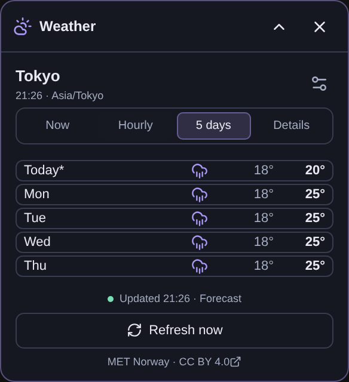
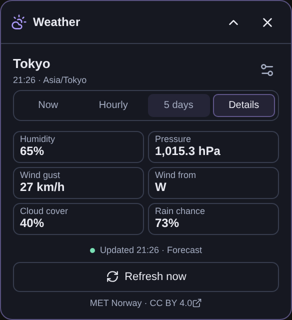

# Weather widget

Open **Desktop Widgets**, choose a Weather city and open the panel. Weather is opt-in, free and API-key-free, using MET Norway's Locationforecast service. It is forecast data, not a live station observation.

## Fixed views

- **Now:** temperature, estimated feels-like, wind speed and precipitation for the labeled provider interval.
- **Hourly:** up to 24 forecast samples for the next day, four at a time. Use Previous/Next; no widget scrolling is needed.
- **5 days:** up to five local days, with temperature minimum/maximum from available samples. Today is marked with an asterisk; it is partial and only includes remaining hours. Sparse 6-hour forecast samples may not capture a daily extreme; values are forecast ranges, not measured daily records.
- **Details:** humidity, sea-level pressure, gusts, direction the wind comes from, cloud cover and rain probability where the provider supplies them. A missing value is shown as `—`, never as a made-up zero.

Rain amounts refer to the provider's next 1/6/12-hour window, shown in the tooltip. They are not a daily sum. Feels-like estimates use wind chill in cold/windy conditions and a heat-index approximation in hot/humid conditions; otherwise they follow air temperature. They are estimates, not provider measurements.

<table>
  <tr>
    <td></td>
    <td></td>
  </tr>
</table>

Screenshots use demonstration data.

## Location and units

City presets include IANA time zones. Forecast clocks and day boundaries use the selected location's zone, including daylight-saving transitions. Legacy saved preset cities infer their zone. Custom coordinates use the device zone until you choose one in **Weather settings → Custom location**. Change Celsius/Fahrenheit in the same editor. No GPS or IP geolocation is used.

## Connectivity and privacy

Readings show retrieval time and cached status. The normal refresh interval is 15 minutes. Failed requests retry after a minute; provider Retry-After is honored. Readings older than one hour are not displayed as current. Hidden windows pause scheduled requests until visible. Manual refresh has a short cooldown.

Native Electron uses IPC and the OS network stack; development/preview uses a fixed same-origin endpoint. These do not permit arbitrary URL proxying. The provider receives manually selected coordinates and standard network metadata; notes, tasks and file lists are not part of a forecast request. [Privacy](PRIVACY.md).

[MET Norway terms and attribution](https://api.met.no/doc/TermsOfService) · Data licensed CC BY 4.0. The live-provider workflow checks real access separately from deterministic service/UI tests. Cloud development environments may require an explicit `api.met.no` domain grant; this is separate from the installed app's own connection.
